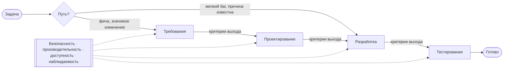

# DLP на русском: скилл для Claude

Скилл, который ведёт ИИ-агента по полному циклу разработки: **требования → проектирование → разработка → тестирование**. Агент не бросается сразу писать код. Сначала он выбирает путь, находит ограничения проекта, готовит документы по шаблонам и переходит к следующей фазе только после того, как выполнены её критерии выхода.

Это неофициальный русский перевод [Development Lifecycle Protocol (DLP)](https://github.com/edgarjs/dlp) от edgarjs (MIT), упакованный в формат [Agent Skills](https://agentskills.io/specification). Читать онлайн без установки: [артефакт в Claude](https://claude.ai/artifact/Wb55qWNUFu34yJpwA4sjsU).

## Как это работает



- **Два пути.** Стандартный путь для фич и значимых изменений проходит все четыре фазы. Минимальный путь для небольшого бага с известной причиной: исправить, протестировать, закоммитить.
- **Первый ответ агента** всегда начинается с блока «Путь / Ограничения / Фаза / Сквозные аспекты». Так сразу видно, как он понял задачу.
- **Сначала артефакты, потом код.** Спецификация, пользовательские истории, ADR, архитектура, модель данных и контракт API пишутся по шаблонам из `templates/`.
- **Критерии выхода.** У каждой фазы есть чек-лист, без которого переход дальше запрещён.
- **Сквозные аспекты** проверяются на каждой фазе.

## Установка

**Claude Code, через маркетплейс:**

```
/plugin marketplace add clunkyharp/dlp-ru-skill
/plugin install dlp-ru@dlp-ru
```

**Claude Code, вручную:** скопируйте папку `plugins/dlp-ru/skills/dlp-ru` в `~/.claude/skills/` (для всех проектов) или в `.claude/skills/` (для одного проекта).

**claude.ai:** упакуйте папку `plugins/dlp-ru/skills/dlp-ru` в zip и загрузите в настройках, в разделе Skills ([инструкция](https://support.claude.com/en/articles/12512198-creating-custom-skills)). Нужен платный тариф с включённым выполнением кода.

Как вызвать: «сделай по DLP», «пройди цикл разработки для этой фичи», «начни с требований». Скилл включается и сам, когда задача про новую фичу или значимое изменение.

## Структура

```
plugins/dlp-ru/skills/dlp-ru/
├── SKILL.md              правила для агента: пути, фазы, критерии выхода
└── references/
    ├── foundations/      принципы, термины, принятие решений, рабочие пути
    ├── requirements/     сбор, анализ, истории, спецификация, валидация
    ├── design/           подходы, архитектура, данные, API, ревью проекта
    ├── development/      окружение, ошибки, зависимости, git, процесс реализации
    ├── testing/          стратегия, практики, дизайн тестов, автоматизация, сопровождение
    ├── concerns/         безопасность, производительность, доступность, наблюдаемость
    └── templates/        шаблоны артефактов
```

`SKILL.md` грузится в контекст целиком. Документы из `references/` агент открывает по одному, только для текущей фазы, поэтому контекст не забивается.

## Первоисточники

**Протокол и формат скилла**
- [Development Lifecycle Protocol](https://github.com/edgarjs/dlp): оригинал, MIT
- [Agent Skills: спецификация](https://agentskills.io/specification)
- [Agent Skills: обзор от Anthropic](https://platform.claude.com/docs/en/agents-and-tools/agent-skills/overview)
- [Скиллы в Claude Code](https://code.claude.com/docs/en/skills) и [маркетплейсы плагинов](https://code.claude.com/docs/en/plugin-marketplaces)
- [anthropics/skills](https://github.com/anthropics/skills): примеры скиллов от Anthropic

**Требования**
- [ISO/IEC/IEEE 29148:2018](https://www.iso.org/standard/72089.html): инженерия требований (стандарт платный)
- [INVEST in Good Stories](https://xp123.com/invest-in-good-stories-and-smart-tasks/), Bill Wake, 2003

**Проектирование**
- [Documenting Architecture Decisions](https://cognitect.com/blog/2011/11/15/documenting-architecture-decisions), Michael Nygard, 2011 (ADR)
- [C4 model](https://c4model.com/), Simon Brown
- [OpenAPI Specification 3.1](https://spec.openapis.org/oas/v3.1.0.html)

**Разработка**
- [Semantic Versioning 2.0.0](https://semver.org/)
- [Conventional Commits 1.0.0](https://www.conventionalcommits.org/en/v1.0.0/)

**Тестирование**
- [Test Pyramid](https://martinfowler.com/bliki/TestPyramid.html), Martin Fowler

**Сквозные аспекты**
- [OWASP Top 10:2025](https://top10.owasp.org/2025) и [OWASP ASVS 5.0](https://asvs.owasp.org/)
- [WCAG 2.2](https://www.w3.org/TR/WCAG22/), рекомендация W3C
- [Core Web Vitals](https://web.dev/articles/vitals)
- [Monitoring Distributed Systems](https://sre.google/sre-book/monitoring-distributed-systems/), Google SRE (четыре золотых сигнала)
- [OpenTelemetry](https://opentelemetry.io/docs/)

## О переводе

Перевод сделан с помощью ИИ, затем построчно сверен с оригиналом. Носитель языка его не вычитывал. Если формулировки расходятся, верен английский оригинал. Служебные файлы оригинала (`CHANGELOG.md`, `install.sh`) не переведены. Его `AGENTS.md` переложен в `SKILL.md`.

Нашли ошибку? Откройте issue или PR.

## Лицензия

MIT, см. [LICENSE](LICENSE). © 2026 Development Standard Protocol (оригинал). Перевод и упаковка: [clunkyharp](https://github.com/clunkyharp).
