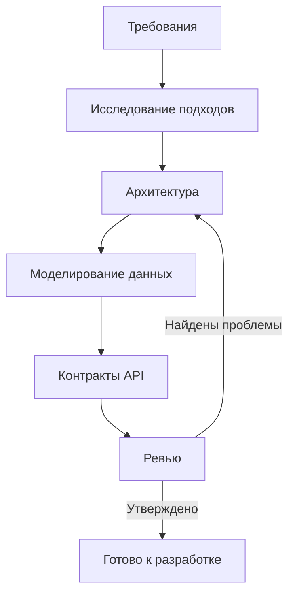

# Фаза проектирования

Превратите проверенные требования в технический чертёж. Проектирование перекидывает мост между тем, что нужно построить, и тем, как это будет построено.

---

## Краткое описание фазы

| Аспект | Детали |
| --- | --- |
| **Цель** | Определить, КАК структурировать решение |
| **Условия входа** | Проверенная спецификация требований |
| **Условия выхода** | Проверенный и утверждённый проект, готовый к реализации |
| **Ключевые артефакты** | Документ об архитектуре, модели данных, контракты API, проектные решения |
| **Шаблоны** | `templates/architecture.md`, `templates/data-model.md`, `templates/api-contract.yml`, `templates/design-decision.md` |

---

## Назначение

Работа над проектом отвечает на вопрос: «Как мы структурируем это решение?»

Без осознанного проектирования:

- Реализация превращается в исследовательское программирование
- По кодовой базе возникают несогласованные паттерны
- Проблемы интеграции всплывают поздно
- От ситуативных решений накапливается технический долг

## Входы и выходы

**Входы:**

- Проверенная спецификация требований
- Ограничения (технологии, ресурсы, сроки)
- Контекст существующей системы (если применимо)

**Выходы:**

- Архитектура, определяющая компоненты и их связи
- Модели данных для сущностей системы
- Контракты интерфейсов между компонентами
- Проверенный и утверждённый проект, готовый к реализации

## Содержание

| Документ | Назначение |
| --- | --- |
| [exploration.md](exploration.md) | Оценка подходов до того, как выбрать один |
| [architecture.md](architecture.md) | Определение структуры системы верхнего уровня и компонентов |
| [data-modeling.md](data-modeling.md) | Проектирование структур данных и связей |
| [api-contracts.md](api-contracts.md) | Определение интерфейсов и формализация контрактов |
| [design-review.md](design-review.md) | Проверка проекта перед реализацией |

## Порядок чтения

Проходите документы последовательно, хотя итерации ожидаемы:

1. **exploration.md** — рассмотрите подходы до того, как зафиксироваться
2. **architecture.md** — определите общую структуру
3. **data-modeling.md** — спроектируйте представления данных
4. **api-contracts.md** — определите интерфейсы и контракты компонентов
5. **design-review.md** — проверьте проект

## Процесс



Проектирование итеративно. Решения на поздних этапах могут потребовать возврата к ранним.

## Ключевые принципы

- **Проектируйте под текущие требования** — избегайте спекулятивной архитектуры (YAGNI)
- **Делайте компромиссы явными** — документируйте, под что вы оптимизируете и чем жертвуете
- **Предпочитайте простые решения** — сложность должна быть оправдана требованиями (KISS)
- **Проектируйте с расчётом на изменения** — хороший проект допускает эволюцию без переписывания
- **Проверяйте рано** — проводите ревью проекта до значительных вложений в реализацию

## Глубина проектирования

Соизмеряйте глубину проектирования со сложностью проекта:

**Минимальное проектирование** (небольшие фичи, исправления багов):

- Определите затронутые компоненты
- Проверьте подход коротким исследованием
- Переходите к реализации

**Стандартное проектирование** (новые фичи, умеренная сложность):

- Полное исследование подходов
- Архитектурные решения задокументированы
- Ключевые интерфейсы определены
- Проект прошёл ревью

**Обширное проектирование** (крупные системы, высокий риск):

- Всестороннее исследование с прототипами
- Подробная архитектурная документация
- Полные контракты интерфейсов
- Формальное ревью проекта со стейкхолдерами

## Чек-лист выхода: когда переходить к разработке

Выполните ВСЕ пункты, прежде чем переходить к фазе РАЗРАБОТКИ:

```text
- [ ] Архитектура охватывает все требования
- [ ] Модели данных поддерживают все сценарии использования
- [ ] Интерфейсы между компонентами определены
- [ ] Проект прошёл ревью и утверждён
- [ ] Не осталось значительных неисследованных рисков
- [ ] Команда могла бы реализовать по проектной документации
```

Если какой-либо пункт списка не выполнен, продолжайте работу над проектом.

---

## Сквозные аспекты для учёта

При проектировании учитывайте:

- **Безопасность** (`concerns/security.md`) — установите границы доверия, спроектируйте аутентификацию/авторизацию, запланируйте шифрование
- **Производительность** (`concerns/performance.md`) — проектируйте с расчётом на эффективность, рано выявляйте узкие места
- **Доступность** (`concerns/accessibility.md`) — с самого начала проектируйте инклюзивные интерфейсы
- **Наблюдаемость** (`concerns/observability.md`) — запланируйте инфраструктуру логирования, метрик и трассировки
