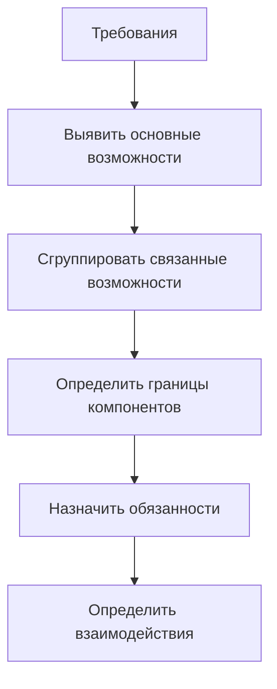
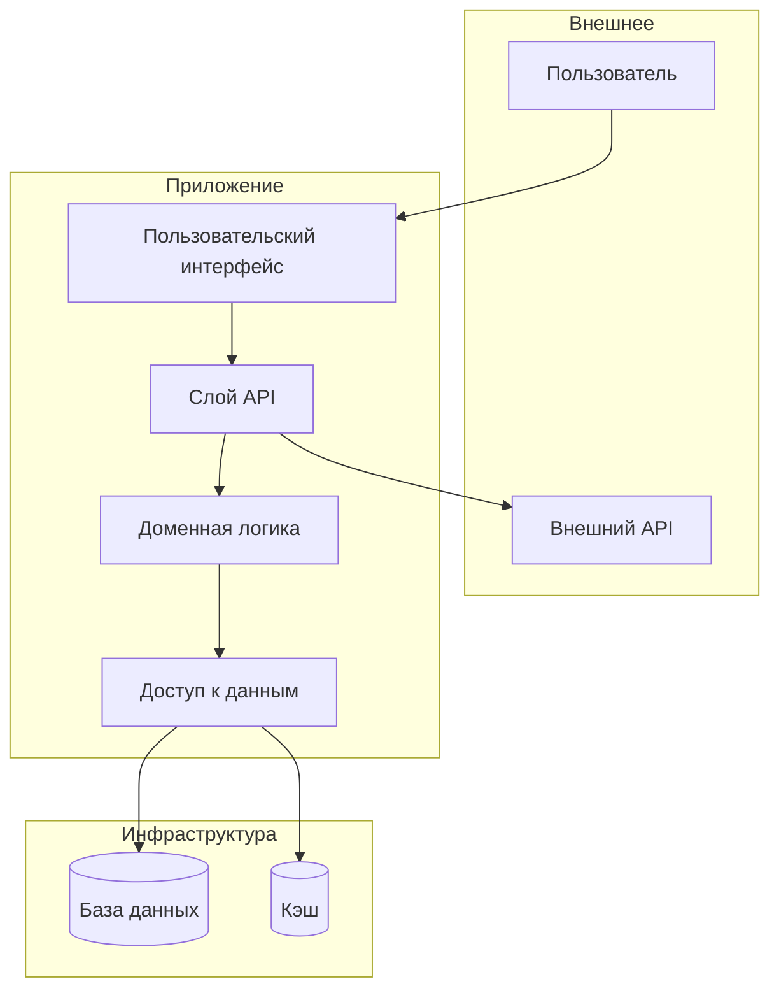

# Архитектура

Архитектура определяет структуру системы верхнего уровня: её компоненты, их обязанности и то, как они взаимодействуют. Архитектурные решения — те, которые дорого менять позже.

---

## Что определяет архитектура

Архитектура отвечает на структурные вопросы:

- Каковы основные компоненты системы?
- Что делает каждый компонент?
- Как компоненты общаются?
- Каковы границы между компонентами?
- Какие решения принимаются на этом уровне, а какие оставляются для реализации?

Архитектура не определяет детали реализации. Она задаёт каркас, который заполняет реализация.

---

## Компоненты

Компоненты — строительные блоки архитектуры. Каждый компонент инкапсулирует связный набор обязанностей.

### Выявление компонентов

Компоненты вытекают из требований и анализа предметной области:



### Характеристики компонента

У хорошо определённых компонентов есть:

**Чёткая обязанность** — каждый компонент хорошо делает одно дело. Обязанность выражается одним-двумя предложениями.

**Определённый интерфейс** — то, как другие компоненты взаимодействуют с этим, явно и ограничено.

**Внутренняя связность** — элементы внутри компонента относятся друг к другу; они меняются по одним и тем же причинам.

**Слабая связанность** — компонент зависит от других через стабильные интерфейсы, а не через внутренние детали.

### Документирование компонентов

Для каждого компонента зафиксируйте:

```text
Компонент: [Название]

Обязанность:
[Что делает этот компонент, 1–2 предложения]

Интерфейсы:
- [Что он предоставляет другим компонентам]
- [Что он потребляет от других компонентов]

Ключевое поведение:
- [Важная возможность 1]
- [Важная возможность 2]

Внутренние заметки:
[Любые решения о внутренней структуре, которые стоит зафиксировать]
```

---

## Взаимодействия компонентов

Архитектура определяет, как компоненты общаются и зависят друг от друга.

### Паттерны взаимодействия

**Синхронный запрос/ответ** — один компонент вызывает другой и ждёт ответа.

- Просто понять
- Создаёт жёсткую временную связанность
- Сбой в одном влияет на вызывающего

**Асинхронный обмен сообщениями** — один компонент отправляет сообщение, не дожидаясь ответа.

- Более слабая связанность
- Сложнее реализовывать и отлаживать
- Лучшая изоляция сбоев

**Общие данные** — компоненты общаются через общее состояние.

- Просто, когда применимо
- Создаёт связанность через структуру данных
- Требует аккуратной координации

**События** — компоненты порождают события, на которые подписываются другие.

- Очень слабая связанность
- Компонентам не нужно знать друг о друге
- Труднее проследить поток

### Направление зависимостей

Определите, какие компоненты от каких зависят:

**Принцип: зависимости направлены в сторону стабильности**

Стабильные компоненты (меняются редко):

- Основная доменная логика
- Фундаментальные структуры данных

Изменчивые компоненты (меняются часто):

- Пользовательские интерфейсы
- Внешние интеграции

Изменчивые компоненты должны зависеть от стабильных, а не наоборот.

### Как избегать циклических зависимостей

Циклические зависимости указывают на плохо определённые границы:

Проблема:

```text
Компонент A зависит от Компонента B
Компонент B зависит от Компонента A
```

Решения:

1. Объединить A и B (возможно, это один компонент)
2. Выделить общую функциональность в Компонент C
3. Использовать события/колбэки, чтобы разорвать цикл
4. Ввести интерфейс, который реализует один из них

---

## Архитектурные диаграммы

Визуальные представления проясняют связи между компонентами.

### Соглашения для диаграмм

Используйте единообразные соглашения:

- **Прямоугольники** обозначают компоненты
- **Стрелки** обозначают зависимости (стрелка направлена от зависимого к тому, от кого зависят)
- **Подписи** на стрелках описывают характер взаимодействия
- **Границы** (пунктирные линии) группируют связанные компоненты

### Пример архитектурной диаграммы



### Уровни диаграмм

Разные уровни детализации служат разным целям:

**Уровень контекста (Context)** — система как чёрный ящик, показывающий внешние взаимодействия

**Уровень контейнеров (Container)** — основные компоненты и их связи

**Уровень компонентов (Component)** — внутренняя структура одного контейнера

Соизмеряйте уровень детализации с аудиторией и целью.

---

## Архитектурные решения

Некоторые решения имеют архитектурное значение: они влияют на структуру и их дорого менять.

### Выявление архитектурных решений

Решения архитектурные, когда они:

- Затрагивают несколько компонентов
- Трудно обратимы
- Ограничивают будущий выбор
- Требуют значительных вложений в реализацию

### Документирование архитектурных решений

Для значимых решений записывайте:

```text
Решение: [Название]

Статус: [Предложено | Принято | Устарело | Заменено]

Контекст:
[Какая ситуация потребовала этого решения?]

Решение:
[Что было решено?]

Последствия:
[Каковы следствия этого решения?]

Рассмотренные альтернативы:
[Какие другие варианты оценивались?]
```

---

## Проверка архитектуры

Архитектура должна удовлетворять требованиям. Проверьте соответствие:

### Соответствие архитектуры и требований

Для каждого основного требования:

- Какие компоненты его обеспечивают?
- Ясно ли распределение обязанностей?
- Охвачены ли все части требования?

Для каждого компонента:

- Каким требованиям он служит?
- Оправдан ли каждый компонент требованиями?
- Правильно ли ограничены обязанности?

### Чек-лист качества архитектуры

- [ ] У каждого компонента чёткая единственная обязанность
- [ ] Границы компонентов совпадают с вероятными паттернами изменений
- [ ] Зависимости направлены в сторону стабильности
- [ ] Циклических зависимостей нет
- [ ] Интерфейсы между компонентами определены
- [ ] Все требования отображены на компоненты
- [ ] Нет компонента, не оправданного требованиями
- [ ] Сценарии сбоев рассмотрены
- [ ] Требования к масштабируемости учтены
- [ ] Границы безопасности установлены

---

## Типичные архитектурные паттерны

Узнавайте распространённые паттерны и когда они применимы:

### Слоистая архитектура (Layered Architecture)

Компоненты организованы в слои; каждый слой зависит только от слоёв ниже.

```text
Слой представления
       ↓
Слой приложения
       ↓
Слой домена
       ↓
Слой инфраструктуры
```

**Когда использовать:** чёткое разделение ответственности; хорошо понятная предметная область.

**Компромиссы:** может приводить к жёстким структурам; изменения могут «расходиться» по слоям.

### Модульная архитектура (Modular Architecture)

Компоненты организованы вокруг функций или возможностей, а не технических слоёв.

```text
Модуль пользователей    Модуль товаров    Модуль заказов
     ↓                      ↓                  ↓
              Общая инфраструктура
```

**Когда использовать:** функции относительно независимы; структура команды согласуется с модулями.

**Компромиссы:** общие аспекты нужно тщательно контролировать; может приводить к дублированию.

### Событийно-ориентированная архитектура (Event-Driven Architecture)

Компоненты общаются преимущественно через события.

```text
Производитель → Шина событий → Потребитель A
                             → Потребитель B
                             → Потребитель C
```

**Когда использовать:** слабая связанность критична; сложные рабочие процессы; несколько потребителей.

**Компромиссы:** труднее проследить поток; проблемы согласованности в конечном счёте; сложная отладка.

---

## Эволюция архитектуры

Архитектура не фиксирована: она развивается вместе с системой.

### Когда пересматривать архитектуру

- Требования существенно изменились
- Возникли проблемы с производительностью
- Изменилась структура команды
- Сместились технические ограничения
- Накопленный технический долг стал болезненным

### Безопасная эволюция

Когда архитектуру необходимо менять:

1. Тщательно поймите текущую архитектуру
2. Определите, что именно нужно менять
3. Планируйте инкрементальную миграцию (не «большой взрыв»)
4. Поддерживайте старое и новое во время перехода
5. Проверяйте сохранение поведения на каждом шаге

---

## После архитектуры

Когда архитектура определена:

1. Задокументируйте компоненты и их обязанности
2. Задокументируйте ключевые архитектурные решения
3. Создайте диаграммы для коммуникации
4. Переходите к моделированию данных и проектированию интерфейсов
5. Используйте архитектуру как основу для всего последующего проектирования

Архитектура ограничивает и направляет детальное проектирование. Решения реализации должны соответствовать архитектурному замыслу.
