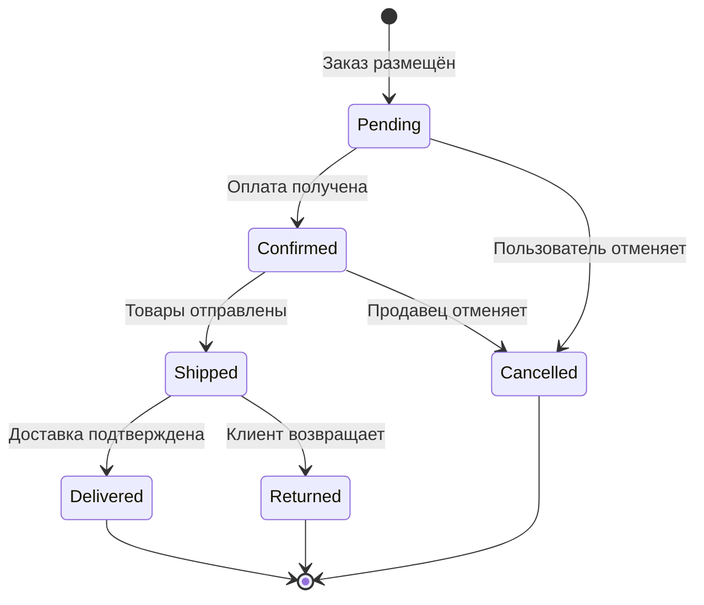

# Моделирование данных

Моделирование данных проектирует структуры, представляющие информацию в системе. Хорошие модели данных точно отражают предметную область и поддерживают операции, которые должна выполнять система.

---

## Что определяет моделирование данных

Моделирование данных отвечает на вопросы об информации:

- Какие сущности существуют в предметной области?
- Какие атрибуты есть у каждой сущности?
- Как сущности связаны друг с другом?
- Какие ограничения определяют допустимые данные?
- Как данные меняются со временем?

---

## Выявление сущностей

Сущности — это то, о чём системе нужно знать.

### Поиск сущностей

Сущности вытекают из требований:

```text
Требование: "Пользователи могут создавать заказы, содержащие товары"

Выявленные сущности:
- User (Пользователь) — человек, размещающий заказы
- Order (Заказ) — запрос на покупку
- Product (Товар) — то, что можно купить
- (OrderItem (Позиция заказа) — связывает заказы с товарами и количеством)
```

### Сущность или атрибут

Не всё является сущностью. Некоторые вещи — атрибуты сущностей:

```text
Вопрос: «Адрес» — это сущность или атрибут?

Подумайте:
- Есть ли у него независимая идентичность? (Можно ли сослаться на "Адрес №123"?)
- Ссылаются ли несколько сущностей на один и тот же адрес?
- Есть ли у него собственный жизненный цикл?

Если да → скорее всего, сущность
Если нет → скорее всего, атрибут или встроенное значение
```

### Документирование сущностей

Для каждой сущности:

```text
Сущность: Order

Описание:
Запрос на покупку товаров, размещённый пользователем.

Атрибуты:
- id: UUID (первичный ключ)
- user_id: UUID (ссылка на пользователя, сделавшего заказ)
- status: текущее состояние (pending, confirmed, shipped, delivered, cancelled)
- total_amount: сумма по всем позициям
- created_at: когда заказ был размещён
- updated_at: когда заказ последний раз изменялся

Жизненный цикл:
Создаётся, когда пользователь оформляет заказ → Обновляется по мере смены статуса →
Хранится бессрочно для учёта

Ограничения:
- Должна быть хотя бы одна позиция заказа
- Итоговая сумма должна равняться сумме по позициям
- Переходы статусов следуют определённому конечному автомату
```

---

## Первичные ключи

Каждой сущности нужен уникальный идентификатор — её первичный ключ.

### UUID и автоинкрементные целые числа

**В большинстве случаев предпочитайте UUID автоинкрементным целым числам** в качестве первичных ключей.

**UUID (Universally Unique Identifiers, универсально уникальные идентификаторы):**

Преимущества:

- Глобально уникальны без координации
- Могут генерироваться на клиенте или на сервере
- Безопасно показывать в URL, не раскрывая информации
- Нет уязвимости перебора по последовательности
- Проще для распределённых систем и шардирования
- Нет коллизий при слиянии данных из разных источников

Недостатки:

- Больше места (16 байт против 4–8 байт)
- Хуже читаются человеком
- Индексные операции чуть медленнее (используйте UUIDv7, чтобы избежать этого)
- Не сортируются естественным образом по времени создания (при необходимости используйте UUIDv7)

### Форматы UUID

```text
UUIDv4 (случайный):
  550e8400-e29b-41d4-a716-446655440000
  Стандартный выбор, криптографически случайный

UUIDv7 (упорядоченный по времени):
  018e8400-e29b-71d4-a716-446655440000
  Сортируется по времени создания, лучше для индексации в базе данных
  Предпочтителен для новых систем

Пример сущности с UUID:
  Сущность: User
  Атрибуты:
    - id: UUID (первичный ключ, UUIDv7)
    - email: string (уникальный)
    - created_at: timestamp
```

### Заметки по реализации

```text
Большинство баз данных поддерживает UUID нативно:
  PostgreSQL: тип uuid, gen_random_uuid()
  MySQL 8.0+:  тип uuid (binary(16)), UUID()
  SQLite:      text или blob, генерировать в приложении
  MongoDB:     ObjectId (похожая идея, 12 байт)

Библиотеки приложений:
  JavaScript:  crypto.randomUUID() (встроено)
  Python:      uuid.uuid4(), uuid.uuid7()
  Rust:        крейт uuid
  Go:          пакет google/uuid
```

---

## Связи

Сущности соединяются друг с другом через связи.

### Типы связей

**Один к одному** — каждый экземпляр A связан ровно с одним экземпляром B.

```text
User ←→ Profile
У каждого пользователя ровно один профиль; каждый профиль принадлежит одному пользователю.
```

**Один ко многим** — каждый экземпляр A связан с несколькими экземплярами B.

```text
User ←→ Orders
У пользователя может быть много заказов; каждый заказ принадлежит одному пользователю.
```

**Многие ко многим** — несколько экземпляров A связаны с несколькими экземплярами B.

```text
Orders ←→ Products
В заказе может быть много товаров; товар может быть во многих заказах.
(Часто моделируется через связующую сущность: OrderItem)
```

### Атрибуты связей

Иногда у самих связей есть атрибуты:

```text
Связь Order ←→ Product требует:
- quantity (сколько этого товара в этом заказе)
- unit_price (цена на момент заказа, может отличаться от текущей цены товара)

Это подсказывает связующую сущность: OrderItem
с атрибутами: order_id, product_id, quantity, unit_price
```

### Документирование связей

```text
Связь: User → Orders

Тип: один ко многим
Описание: пользователь размещает заказы со временем.
Мощность: у пользователя может быть ноль или больше заказов.
          Заказ принадлежит ровно одному пользователю.
Ограничения: удаление пользователя требует обработки его заказов.
```

---

## Ограничения

Ограничения определяют правила, которым должны удовлетворять допустимые данные.

### Типы ограничений

**Ограничения существования** — что должно существовать?

- У каждого заказа должен быть пользователь
- У каждой позиции заказа должны быть заказ и товар

**Ограничения уникальности** — что должно быть уникальным?

- Адреса электронной почты пользователей должны быть уникальными
- Только одна активная подписка на пользователя

**Ограничения значений** — какие значения допустимы?

- Количество в заказе должно быть положительным
- Email должен быть корректного формата
- Статус должен быть одним из определённых значений

**Ограничения связей** — какие связи должны выполняться?

- Итог заказа должен равняться сумме позиций заказа
- Отправленный заказ нельзя отменить

**Временные ограничения** — какие временные правила применяются?

- updated_at должно быть >= created_at
- end_date подписки должна быть > start_date

---

## Управление состоянием

Некоторые сущности меняют состояние со временем. Моделируйте переходы состояний явно.

### Конечные автоматы

Для сущностей со сложным жизненным циклом:



### Правила переходов состояний

Документируйте, что управляет переходами:

```text
Переход состояния: Pending → Confirmed
Триггер: успешная обработка платежа
Действия: создать запись о платеже, отправить письмо с подтверждением
Условия (guards): в заказе есть хотя бы одна позиция, товар в наличии

Переход состояния: Confirmed → Cancelled
Триггер: запрос на отмену
Условия (guards): заказ ещё не отправлен
Действия: вернуть платёж, восстановить остатки, отправить письмо об отмене
```

---

## Подходы к моделированию данных

### Начинайте с понятий предметной области

Моделируйте предметную область, а не решение:

Плохо: модель на основе экранов интерфейса

```text
Screen1Data, Screen2Data, FormSubmission
```

Лучше: модель на основе понятий предметной области

```text
User, Product, Order, Payment
```

### Нормализуйте обдуманно

Нормализация сокращает избыточность, но добавляет сложность:

**Нормализуйте, когда:**

- Целостность данных критична
- Обновления общих данных должны быть согласованными
- Важна эффективность хранения

**Денормализуйте, когда:**

- Производительность чтения критична
- Данные читаются гораздо чаще, чем записываются
- Целостность можно поддерживать другими средствами

### Учитывайте паттерны доступа

То, как к данным будут обращаться, влияет на то, как их следует моделировать:

```text
Паттерн доступа: "Показать заказ со всеми позициями и сведениями о товарах"

Нормализовано: Order → OrderItem → Product (несколько обращений)
Денормализовано: Order содержит встроенные позиции с информацией о товарах (одно обращение)

Компромисс: денормализованный вариант быстрее читать, но сложнее обновлять,
            если информация о товаре меняется.
```

---

## Чек-лист моделирования

- [ ] Все сущности из требований выявлены
- [ ] У каждой сущности есть ясная идентичность и назначение
- [ ] Первичные ключи определены (предпочитайте UUID для сущностей, видимых пользователю)
- [ ] Атрибуты отнесены к подходящим сущностям
- [ ] Связи между сущностями определены
- [ ] Мощность связей указана
- [ ] Ограничения задокументированы
- [ ] Конечные автоматы смоделированы для сущностей с состоянием
- [ ] Паттерны доступа учтены
- [ ] Решения о нормализации осознанные
- [ ] Модель поддерживает все необходимые операции

---

## Типичные ошибки моделирования

**Преждевременная денормализация** — оптимизация под производительность чтения до того, как доказана потребность. Начинайте с нормализованной модели; денормализуйте, когда это оправдывают измерения.

**Пропущенные ограничения** — ограничения тоже требования. Если данные должны подчиняться правилам, смоделируйте эти правила.

**Смешение сущностей и атрибутов** — то, что две вещи названы похоже, не значит, что они связаны. «Имя пользователя» — это не та же сущность, что «Пользователь».

**Игнорирование жизненного цикла** — сущности создаются, изменяются и иногда удаляются. Моделируйте весь жизненный цикл, а не только «счастливое» состояние.

**Избыточное моделирование** — не каждая деталь нуждается в модели. Моделируйте то, что системе нужно знать, а не всё, что теоретически может быть релевантно.

---

## После моделирования данных

Когда модели данных определены:

1. Задокументируйте сущности, атрибуты и связи
2. Задокументируйте ограничения и конечные автоматы
3. Убедитесь, что модели поддерживают все требования
4. Переходите к проектированию API, чтобы определить, как компоненты получают доступ к данным
5. Пересматривайте модели, если проектирование API выявит пробелы

Модели данных фундаментальны: интерфейсы, валидация и хранение строятся на них.
