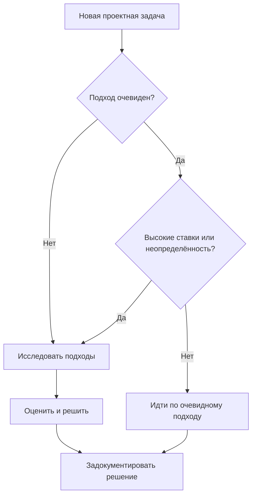
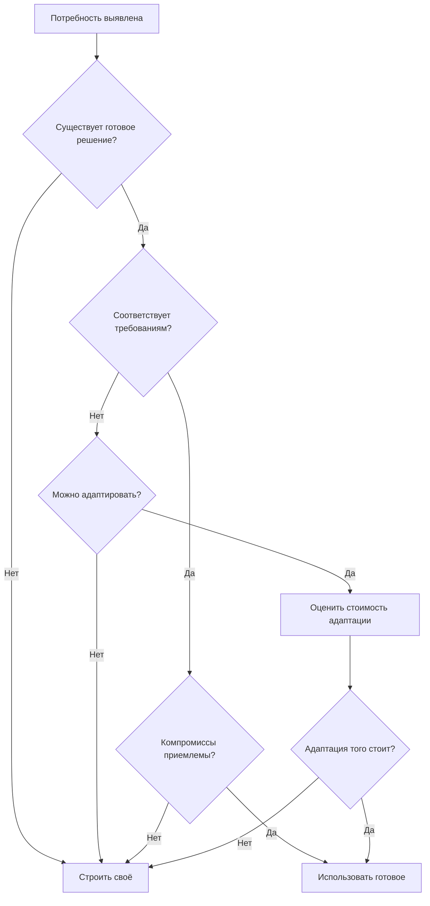

# Исследование проектных подходов

Исследование оценивает подходы до того, как выбрать один. Хорошее исследование предотвращает дорогую смену курса позже, рано выводя на поверхность компромиссы и риски.

---

## Зачем исследовать

Первое решение, которое приходит в голову, редко бывает лучшим. Исследование:

- Открывает варианты, о которых вы иначе не подумали бы
- Выводит компромиссы, которые влияют на решения
- Выявляет риски до того, как они станут проблемами
- Укрепляет уверенность в том, что выбранный подход здравый
- Документирует альтернативы для будущего

## Когда исследовать



Исследуйте, когда:

- Есть несколько жизнеспособных подходов
- Решение дорого отменять
- Требования затрагивают незнакомую территорию
- Предыдущие похожие решения вызвали проблемы
- У стейкхолдеров сильные мнения, которые нужно оценить

Пропускайте исследование, когда:

- Подход действительно очевиден и низкорисков
- Явно применим стандартный паттерн
- Давление по времени экстремальное, а риск низкий
- У вас есть свежий, непосредственно применимый опыт

---

## Формирование вариантов решения

Прежде чем оценивать, сформулируйте варианты. Сопротивляйтесь желанию критиковать преждевременно.

### Как формулировать подходы

Стремитесь к двум-четырём кандидатам. Меньше — вы можете упустить хорошие варианты; больше — получите паралич анализа.

**Приёмы формулировки вариантов:**

- **Меняйте ось** — измените одно фундаментальное допущение и посмотрите, какой подход из этого вытекает
- **Изучайте** — как другие решали похожие проблемы?
- **Крайности** — какое самое простое возможное решение? Самое надёжное? Самое быстрое?
- **Ограничения** — что если бы у вас было вдвое меньше времени? Вдвое больше ресурсов? Никаких внешних зависимостей?

### Документирование кандидатов

Для каждого кандидата зафиксируйте:

```text
Подход: [Название/идентификатор]

Описание:
[Краткое объяснение того, как работает этот подход]

Ключевые характеристики:
- [Заметная особенность или качество]
- [Ещё одна характеристика]

Первичная оценка:
[Предварительные мысли о жизнеспособности]
```

---

## Анализ компромиссов

Когда кандидаты есть, проанализируйте их систематически.

### Измерения компромиссов

Оцените каждый подход по значимым измерениям:

**Сложность** — насколько трудно это понять, реализовать и поддерживать?

**Производительность** — как это поведёт себя под нагрузкой и в масштабе?

**Гибкость** — насколько легко это допускает будущие изменения?

**Риск** — что может пойти не так? Что неизвестно?

**Трудозатраты** — сколько работы требуется на реализацию?

**Зависимости** — что это требует такого, что мы не контролируем?

Не все измерения одинаково важны для каждого решения. Определите, какие из них самые важные в вашем контексте.

### Таблица сравнения

Организуйте анализ для сравнения:

| Измерение | Подход A | Подход B | Подход C |
| --- | --- | --- | --- |
| Сложность | Низкая | Средняя | Высокая |
| Производительность | Достаточная | Хорошая | Отличная |
| Гибкость | Ограниченная | Хорошая | Отличная |
| Риск | Низкий | Средний | Высокий |
| Трудозатраты | 2 недели | 4 недели | 8 недель |
| Зависимости | Нет | Внешний API | Новая инфраструктура |

### Взвешивание измерений

Когда измерения конфликтуют, определите, какие важнее:

Для этого решения приоритеты таковы:

1. Трудозатраты (сжатые сроки)
2. Риск (боевая система)
3. Производительность (достаточной хватит)
4. Гибкость (низкий приоритет для v1)

---

## Строить самим или использовать готовое

Частое исследование — делать своё или использовать существующие решения.



### Оценка существующих решений

При рассмотрении существующих решений (библиотек, сервисов, фреймворков):

**Оценка соответствия:**

- Решает ли оно настоящую проблему?
- Какой процент требований оно покрывает?
- Что вам придётся строить вокруг него?

**Оценка качества:**

- Активно ли оно поддерживается?
- Достаточна ли документация?
- Каково сообщество и поддержка?
- Каково состояние безопасности?

**Оценка стоимости:**

- Какова кривая обучения?
- Каковы трудозатраты на интеграцию?
- Каковы последствия лицензирования?
- Какова долгосрочная нагрузка по сопровождению?

**Оценка рисков:**

- Что произойдёт, если проект будет заброшен?
- Насколько легко от него отказаться?
- Какова зависимость от вендора/мейнтейнера (lock-in)?

---

## Работа с неопределённостью

Иногда нельзя оценить подходы без дополнительной информации.

### Прототипы и спайки

Когда неопределённость высока, стройте, чтобы узнать:

**Прототип (Prototype)** — быстрая реализация, чтобы проверить осуществимость или лучше понять проблему. Прототипы выбрасываются; их цель — обучение, а не использование в проде.

**Спайк (Spike)** — ограниченное по времени исследование для ответа на конкретный вопрос. У спайков есть чёткие цели и условия завершения.

```text
Спайк: оценить GraphQL для нашего API

Вопрос: справится ли GraphQL с нашей моделью авторизации?

Ограничение по времени: 2 дня

Критерии успеха:
- Реализовать авторизацию для одного сложного запроса
- Задокументировать встреченные ограничения
- Рекомендация: использовать или не использовать
```

### Когда делать прототип

Делайте прототип, когда:

- Осуществимость действительно неясна
- Стоимость прототипа низка по сравнению с ценой ошибки
- Письменный анализ не может разрешить неопределённость
- Нужно что-то продемонстрировать стейкхолдерам

Пропускайте прототип, когда:

- Опыт даёт достаточную уверенность
- Решение легко обратимо
- Давление времени перевешивает неопределённость
- Анализ адекватно покрывает неизвестное

---

## Принятие решения

После исследования решайте и двигайтесь дальше.

### Критерии решения

Выберите подход, который:

- Лучше всего удовлетворяет требованиям
- Согласуется с приоритетами и ограничениями
- Имеет приемлемый профиль рисков
- Поддерживается командой

### Документирование решения

Записывайте решения с достаточным контекстом для будущего обращения:

```text
Решение: использовать подход B (очередь сообщений для фоновых задач)

Контекст:
Нам нужно обрабатывать загрузки асинхронно. Рассматривались три подхода.

Оценённые варианты:
A. Многопоточность внутри процесса — просто, но не переживает перезапуски
B. Очередь сообщений — больше инфраструктуры, но надёжно и масштабируемо
C. Плановая пакетная обработка — просто, но добавляет задержку

Обоснование решения:
Надёжность критична (пользовательские загрузки нельзя терять). Дополнительные
затраты на инфраструктуру оправданы гарантией надёжности.

Принятые компромиссы:
- Дополнительная инфраструктура для поддержки
- Более сложная настройка локальной разработки

Отложенные альтернативы:
Плановую обработку можно пересмотреть для менее критичной пакетной работы.

Дата: 2024-01-15
```

---

## Чек-лист исследования

- [ ] Определено несколько подходов (2–4)
- [ ] Каждый подход кратко задокументирован
- [ ] Измерения компромиссов определены
- [ ] Подходы сравнены по измерениям
- [ ] Приоритеты для этого решения ясны
- [ ] Рассмотрен вопрос «строить или использовать готовое»
- [ ] Неизвестное проработано (анализом или прототипом)
- [ ] Решение принято и задокументировано
- [ ] Обоснование объясняет, почему выбран именно этот подход

---

## Типичные ошибки исследования

**Исследование одного варианта** — оценка только первой идеи. Заставьте себя сформулировать альтернативы.

**Паралич анализа** — бесконечная оценка без решения. Ограничивайте исследование по времени.

**Упущенные измерения** — игнорирование факторов, которые станут важны позже. Учитывайте эксплуатацию, безопасность, поддерживаемость.

**Ловушка невозвратных затрат (sunk cost)** — продолжение слабого подхода из-за прежних вложений. Оценивайте варианты по будущей ценности.

**Преждевременная фиксация** — решение до того, как достаточно исследовали. Сопротивляйтесь желанию сразу начать строить.

---

## После исследования

Когда подход выбран:

1. Задокументируйте решение и обоснование
2. Сообщите затронутым сторонам
3. Переходите к детальной архитектуре и проектированию
4. Возвращайтесь к исследованию, когда возникают вопросы

Артефакт исследования остаётся ценным: он объясняет не только что выбрано, но и что рассматривалось и почему альтернативы отвергнуты.
