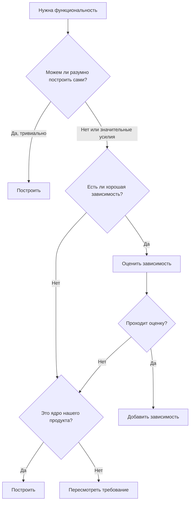
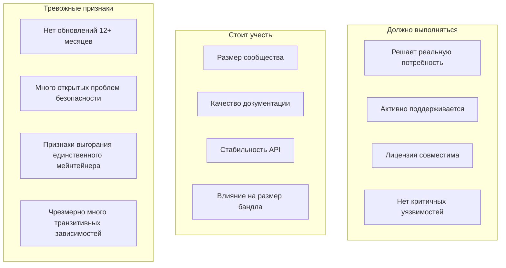

# Управление зависимостями

Зависимости — это внешний код, на который опирается ваш проект. Они ускоряют разработку, но вносят риск. Хорошее управление зависимостями означает получение их выгод при контроле их издержек.

---

## Образ мышления при управлении зависимостями

### Каждая зависимость — это компромисс

Зависимости дают:

- Функциональность, которую не нужно строить
- Экспертизу, которую не нужно наращивать
- Нагрузку по сопровождению, разделённую с другими

Зависимости стоят:

- Ещё одной кодовой базы, которую нужно понимать
- Ещё одного источника багов и уязвимостей
- Ещё одного проекта, который может быть заброшен
- Сложности и размера сборки

### Решение о зависимости



**По умолчанию выбирайте меньше зависимостей.** Лучшая зависимость — часто отсутствие зависимости.

---

## Соблюдение версий

> **ВАЖНО: при добавлении зависимостей всегда используйте последнюю стабильную версию.**

При добавлении любой зависимости вы ОБЯЗАНЫ проверить и использовать текущую последнюю стабильную версию из официального реестра пакетов. Это не обсуждается.

### Когда допустимы более старые версии

Редкие исключения требуют явной документации:

Допустимые причины для более старой версии:

- Ломающие изменения в последней версии несовместимы с ограничениями проекта
- Известный критичный баг в последней версии без обходного пути
- Зависимость от другого пакета, требующего конкретной версии

Необходимая документация:

- Какая версия используется
- Какова последняя стабильная версия
- Почему необходима более старая версия
- План обновления, когда это станет возможным

### Порядок проверки версии

1. Найдите в официальном реестре:
   - npm: npmjs.com/package/[name]
   - PyPI: pypi.org/project/[name]
   - crates.io: crates.io/crates/[name]
   - Go: pkg.go.dev/[import-path]
   - Ruby: rubygems.org/gems/[name]
2. Отметьте текущую последнюю стабильную версию
3. Установите именно эту версию:

```text
npm install package@latest
pip install package # по умолчанию ставит последнюю
cargo add package # по умолчанию ставит последнюю
```

4. Убедитесь, что установленная версия соответствует ожидаемой

---

## Оценка новых зависимостей

Прежде чем добавлять любую зависимость, оцените её систематически.

### Критерии оценки



### Изучайте актуальную информацию

**Критично: всегда ищите актуальную информацию о зависимостях в интернете. Не полагайтесь на данные на момент отсечки знаний.**

При оценке зависимостей или работе с ними:

Всегда ищите в вебе:

- Текущий номер стабильной версии
- Дату последнего релиза и список изменений
- Известные уязвимости (CVE)
- Ломающие изменения в недавних версиях
- Руководства по миграции при крупных обновлениях
- Актуальные лучшие практики для этой зависимости
- URL официальной документации

Почему это важно:

- Экосистемы зависимостей быстро меняются
- Уязвимости безопасности обнаруживаются постоянно
- Происходят устаревания API и ломающие изменения
- Лучшие практики эволюционируют
- Данные на момент отсечки знаний устарели

**Неизвестные технические детали:**

Если вы не знаете:

- Как настроить зависимость
- Как выглядит текущий API
- Как обработать конкретные сценарии использования
- Каковы характеристики производительности
- Каковы ломающие изменения

То вы обязаны:

- ✓ Искать в официальной документации
- ✓ Искать актуальные примеры использования
- ✓ Читать недавние заметки о релизах
- ✓ Проверять issues/обсуждения на GitHub
- ✗ Никогда не гадать и не использовать устаревшие знания
- ✗ Никогда не рекомендовать без проверки

### Оценка размера и охвата

Предпочитайте небольшие сфокусированные зависимости крупным фреймворкам:

- Предпочитайте: `date-fns` (импортируйте только используемые функции)
- Вместо: `moment.js` (загружает всю библиотеку)
- Предпочитайте: отдельные функции lodash (`lodash.debounce`)
- Вместо: полного импорта lodash
- Предпочитайте: сфокусированные библиотеки, которые хорошо делают одно дело
- Вместо: «швейцарских ножей» с множеством функций

---

### Стратегии фиксации версий

**Точная версия (самая строгая):**

```text
"lodash": "4.17.21"
```

Используйте, когда:

- У зависимости есть история ломающих изменений
- Нужны воспроизводимые сборки
- Зависимость критична для безопасности

**Каретка (совместимо с версией):**

```text
"lodash": "^4.17.21"
```

- Допускает: 4.17.22, 4.18.0
- Блокирует: 5.0.0

Используйте, когда:

- Зависимость надёжно следует semver
- Нужны автоматические обновления патчей
- Самый распространённый выбор

**Тильда (только обновления патчей):**

```text
"lodash": "~4.17.21"
```

- Допускает: 4.17.22
- Блокирует: 4.18.0

Используйте, когда:

- Нужны только исправления багов
- Минорные версии вызывали проблемы

**Диапазон (конкретный диапазон):**

```text
"lodash": ">=4.17.0 <5.0.0"
```

Используйте, когда:

- Нужны конкретные ограничения версии
- Нужно обойти известные плохие версии

### Lock-файлы

Всегда коммитьте lock-файлы:

```text
npm:    package-lock.json
yarn:   yarn.lock
pnpm:   pnpm-lock.yaml
pip:    requirements.txt (с зафиксированными версиями) или Pipfile.lock
go:     go.sum
rust:   Cargo.lock
```

Lock-файлы обеспечивают:

- Все используют одинаковые версии
- Сборки воспроизводимы
- Транзитивные зависимости зафиксированы
- Аудиты безопасности точны

---

### Поиск неиспользуемых зависимостей

Инструменты для выявления неиспользуемых зависимостей:

JavaScript:

```text
npx depcheck
npx npm-check
```

Python:

```text
pip-autoremove --list
deptry
```

Go:

```text
go mod tidy (удаляет неиспользуемые)
```

Rust:

```text
cargo machete
```

---

## Чек-лист управления зависимостями

### Добавление зависимостей

- [ ] Задокументирована конкретная потребность
- [ ] Поиск существующих решений выполнен
- [ ] Текущая версия и информация найдены в вебе (а не по данным на момент отсечки знаний)
- [ ] Изучены актуальная документация и лучшие практики
- [ ] Оценено состояние сопровождения
- [ ] Проверена совместимость лицензий
- [ ] Оценены уязвимости безопасности
- [ ] Проверено влияние на размер
- [ ] Зафиксирована подходящая версия
- [ ] Lock-файл закоммичен
- [ ] Решение задокументировано

### Удаление зависимостей

- [ ] Подтверждено, что больше не используется
- [ ] Выполнен поиск по всей кодовой базе
- [ ] Запущен полный набор тестов
- [ ] Документация обновлена
- [ ] Изменения lock-файла закоммичены
