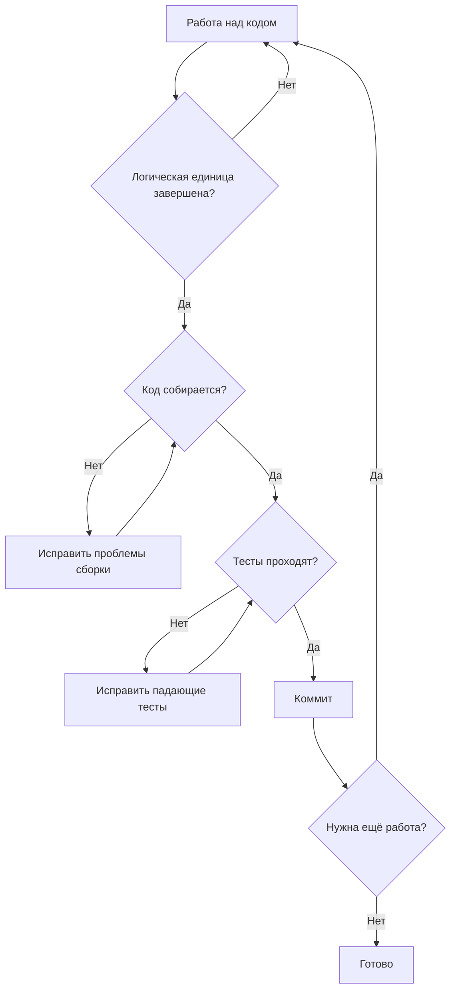
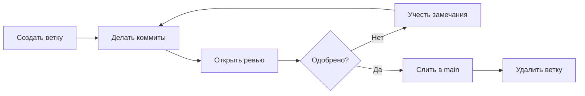

# Рабочий процесс Git

Контроль версий необходим для управления изменениями кода. Этот документ описывает практики эффективного использования Git с упором на создание понятной, удобной для ревью истории.

---

## Философия коммитов

Коммиты — это атомы истории контроля версий. Хорошие коммиты делают историю полезной для понимания, ревью и отладки.

### Что делает коммит хорошим

**Атомарный** — каждый коммит представляет одно логическое изменение.

- Плохо: `"Fixed bug and added feature and refactored utils"`
- Лучше: три отдельных коммита:
  1. `"Fix null check in user validation"`
  2. `"Add email notification on order completion"`
  3. `"Extract date formatting to utility function"`

**Завершённый** — коммит самодостаточен; кодовая база работает после его применения.

- Плохо: коммит, ломающий сборку, а за ним «Fix build»
- Лучше: один коммит, включающий и изменение, и исправление

**Собираемый и тестируемый** — после каждого коммита код компилируется и тесты проходят.

- Коммиты не должны требовать последующих коммитов для работоспособности.
- Каждый коммит — потенциальная точка релиза.

---

## Размер коммитов

### Насколько маленькие

Коммиты должны быть достаточно малы, чтобы:

- Просмотреть за несколько минут
- Понять с первого взгляда
- Откатить, не потеряв несвязанную работу
- Эффективно делать bisect при поиске багов

### Насколько большие

Коммиты должны быть достаточно велики, чтобы:

- Представлять законченную мысль
- Собираться и проходить тесты
- Иметь смысл в изоляции

### Рекомендации

Слишком мелко (это должен быть один коммит):

- `"Add opening brace"`
- `"Add variable declaration"`
- `"Add function body"`

Слишком крупно (это должно быть несколько коммитов):

- `"Implement user authentication system"`

Правильный размер (каждый завершён, тестируем и удобен для ревью):

- `"Add password hashing utility"`
- `"Add user login endpoint with validation"`

---

## Когда коммитить



Коммитьте, когда:

- Логическая единица работы завершена
- Код успешно собирается
- Тесты проходят
- Вы можете написать понятное сообщение коммита о том, что изменилось

Не коммитьте:

- В произвольных точках остановки (конец дня, обеденный перерыв)
- Со сломанной сборкой
- С падающими тестами
- С незавершёнными изменениями

---

## Сообщения коммитов

Сообщения коммитов документируют, что изменилось и почему.

### Структура сообщения

- Краткая сводка (50 символов или меньше)
- Более длинное описание, если нужно. Перенос на 72 символах.
- Объясняйте что и почему, а не как (как показывает код).
- Маркированные списки допустимы для перечисления изменений
- Делайте каждый пункт лаконичным

### Как писать хорошие сообщения

**Начинайте с глагола** — описывайте, что делает коммит.

Хорошо:

```text
"Add user email validation"
"Fix null pointer in order processing"
"Remove deprecated authentication method"
```

Плохо:

```text
"User email validation"
"Bug fix"
"Cleanup"
```

**Будьте конкретны** — общие сообщения бесполезны.

Плохо:

```text
"Fix bug"
"Update code"
"Various changes"
```

Лучше:

```text
"Fix race condition in concurrent order creation"
"Update user model to include timezone field"
"Rename OrderProcessor to OrderService for consistency"
```

**Объясняйте «почему», когда это неочевидно** — diff показывает, что изменилось; сообщение объясняет, почему.

Хорошо:

```text
Use insertion sort for small arrays

Benchmarks show insertion sort outperforms quicksort for
arrays under 50 elements due to lower overhead. This path
is hit frequently in pagination code.
```

---

## Ветвление

Ветки изолируют незавершённую работу от основной кодовой базы.

### Именование веток

Используйте описательные, единообразные имена:

```text
feature/add-user-authentication
fix/order-validation-null-check
refactor/extract-payment-module
```

### Жизненный цикл ветки



### Поддержание веток актуальными

Долгоживущие ветки расходятся с main. Регулярно интегрируйте изменения:

Варианты:

- Rebase на main: создаёт линейную историю
- Слияние main в ветку: сохраняет историю ветки

Работают оба; будьте последовательны в рамках проекта.

---

## Перед коммитом

### Просмотрите свой собственный diff

Перед коммитом просмотрите то, что собираетесь закоммитить:

```text
git diff --staged
```

Проверьте на наличие:

- Непреднамеренных изменений
- Чувствительных файлов (.env, .env.local, credentials.json, *.key, *.pem)
- API-ключей, паролей или секретов в коде
- Отладочного кода
- Временных обходных решений, которые нужно убрать
- Незавершённых изменений

---

## Защита чувствительной информации

**Критическое правило: никогда не коммитьте секреты, учётные данные или чувствительную конфигурацию в систему контроля версий.**

### Что нельзя коммитить

Никогда не коммитьте:

- ✗ Файлы .env, .env.local, .env.production
- ✗ API-ключи, токены доступа, пароли
- ✗ Приватные ключи (.key, .pem, id_rsa)
- ✗ Файлы с учётными данными (credentials.json, secrets.yaml)
- ✗ Строки подключения к базе данных с паролями
- ✗ Секреты клиентов OAuth
- ✗ Подписанные сертификаты
- ✗ Любой файл, содержащий чувствительные данные

### Использование .gitignore

В каждом проекте должен быть файл `.gitignore`, настроенный под его технологический стек.

**Шаблоны .gitignore**

Используйте проверенные шаблоны для вашего стека:

- Node.js: github.com/github/gitignore/blob/main/Node.gitignore
- Python: github.com/github/gitignore/blob/main/Python.gitignore
- Ruby: github.com/github/gitignore/blob/main/Ruby.gitignore
- Rust: github.com/github/gitignore/blob/main/Rust.gitignore
- Go: github.com/github/gitignore/blob/main/Go.gitignore

Или используйте gitignore.io для генерации комбинированных шаблонов

### Управление переменными окружения

Хорошие практики:

- ✓ Храните секреты в файлах `.env` (игнорируемых git)
- ✓ Предоставляйте `.env.example` с фиктивными значениями
- ✓ Документируйте необходимые переменные окружения
- ✓ Проверяйте переменные окружения при запуске
- ✓ Используйте инструменты управления секретами (Vault, AWS Secrets Manager)

---

## Гигиена коммитов

### Атомарные изменения

Если вы поняли, что коммит стоит разделить:

До отправки (push) можно:

- Изменить последний коммит (amend)
- Использовать интерактивный rebase для реорганизации коммитов
- Сделать reset и закоммитить заново лучшими порциями

### Качество истории коммитов

Хорошая история:

- Каждый коммит понятен в изоляции
- Bisect работает (любой коммит можно собрать и протестировать)
- Связанные изменения сгруппированы
- История рассказывает, как развивался код

Плохая история:

- Коммиты «WIP», смешанные с настоящими изменениями
- Коммиты «Fix typo», разбросанные повсюду
- Сломанные коммиты, за которыми следуют исправления
- Коммиты слияния, скрывающие реальную работу

---

## Поддержание коммитов пригодными к релизу

Каждый коммит должен оставлять кодовую базу в рабочем состоянии.

### Почему это важно

- **Bisect** — поиск багов требует, чтобы каждый коммит был запускаемым
- **Revert** — откат требует, чтобы каждый коммит был независимым
- **Ревью** — понимание изменений требует, чтобы каждый коммит имел смысл сам по себе
- **Деплой** — любой коммит потенциально может попасть в продакшен

### Как этого добиться

Подход:

1. Планируйте изменения до начала
2. Реализуйте небольшими завершёнными шагами
3. Проверяйте каждый шаг перед коммитом
4. Объединяйте незавершённую работу перед публикацией

Если у вас грязная локальная история:

- Используйте интерактивный rebase для наведения порядка
- Объединяйте (squash) fixup-коммиты
- Переупорядочивайте коммиты логично
- Это допустимо ДО отправки (push)

---

## Чек-лист рабочего процесса Git

Коммит:

- [ ] Изменение — одна логическая единица
- [ ] Чувствительные файлы и секреты не включены
- [ ] .gitignore настроен правильно
- [ ] Код собирается
- [ ] Тесты проходят
- [ ] Diff просмотрен на предмет непреднамеренных изменений
- [ ] Сообщение коммита чёткое и конкретное

Ветвление:

- [ ] Имя ветки описательное
- [ ] Ветка основана на актуальном main
- [ ] Ветка поддерживается в актуальном состоянии относительно main

Перед слиянием:

- [ ] Все коммиты следуют рекомендациям
- [ ] История чистая (без WIP, fixup-коммитов)
- [ ] Ветка перебазирована/слита с актуальным main
- [ ] CI проходит
