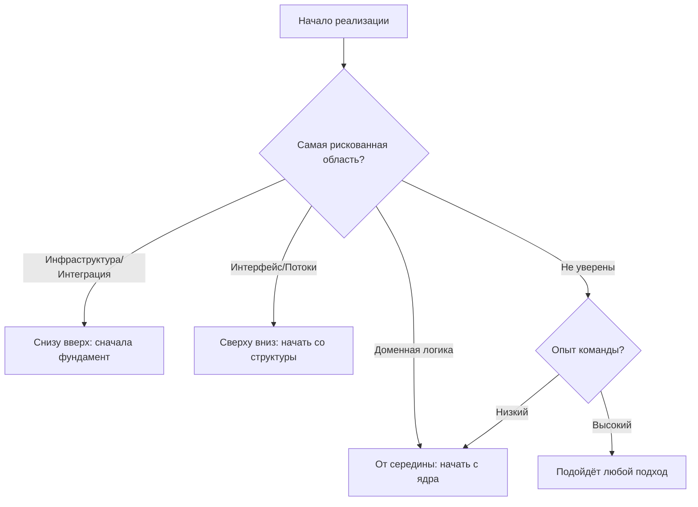

# Процесс реализации

Процесс реализации направляет превращение проекта в код. Дисциплинированный подход даёт лучшие результаты, чем хаотичное кодирование.

---

## Принципы реализации

### Работайте инкрементально

Стройте небольшими проверяемыми шагами, а не большими прыжками.

Плохой подход:

1. Написать весь код
2. Запустить
3. Отлаживать множество проблем

Лучший подход:

1. Реализовать наименьшую полезную часть
2. Проверить, что она работает
3. Закоммитить
4. Реализовать следующую часть
5. Повторять

Преимущества инкрементальной работы:

- Ошибки ловятся рано, рядом с источником
- Прогресс виден и измерим
- Проще сохранять фокус
- Естественные точки для коммитов

### Следуйте проекту

Реализация должна воплощать проект, а не изобретать его заново.

Если проект предписывает:

- Компонент A отвечает за валидацию
- Компонент B отвечает за сохранение

Реализация должна:

- Размещать логику валидации в Компоненте A
- Размещать логику сохранения в Компоненте B

А не:

- Объединять валидацию и сохранение в Компоненте A
- Добавлять новый Компонент C, которого нет в проекте

Если нужны изменения проекта, обновите проектный документ.

### Проверяйте непрерывно

Не ждите конца, чтобы тестировать.

После реализации функции:

- Обрабатывает ли она счастливый путь?
- Обрабатывает ли она крайние случаи?
- Обрабатывает ли она ошибки?
- Проходят ли по-прежнему существующие тесты?

### Автоматизируйте повторяющиеся задачи

Если вы выполняете одну и ту же задачу дважды, автоматизируйте её скриптом.

Признаки того, что нужна автоматизация:

- Повторный запуск одной и той же последовательности команд
- Ручное копирование/преобразование данных между системами
- Выполнение одних и тех же шагов настройки для каждой функции
- Выполнение одних и тех же шагов проверки после изменений
- Применение одного и того же преобразования кода к нескольким файлам

**Правило автоматизации:**

- Первый раз: сделайте вручную, задокументируйте шаги
- Второй раз: напишите скрипт И сразу используйте его (третьего раза нет)

**Когда вы ловите себя на том, что делаете одно и то же дважды:**

1. Остановитесь и распознайте паттерн
2. Напишите скрипт
3. Задокументируйте его
4. Используйте скрипт для этого случая

С этого момента: всегда используйте скрипт, больше никогда не делайте вручную

**Что автоматизировать:**

Хорошие кандидаты:

- ✓ Последовательности сборки и тестирования
- ✓ Настройка и наполнение базы данных
- ✓ Конфигурация окружения
- ✓ Генерация кода из шаблонов
- ✓ Подготовка к развёртыванию
- ✓ Миграция или преобразование данных
- ✓ Проверки и валидация

Плохие кандидаты:

- ✗ Одноразовые операции
- ✗ Задачи, сильно меняющиеся каждый раз
- ✗ Задачи, требующие человеческого суждения
- ✗ Сложные операции, которым лучше подходит специальный инструментарий

**Рекомендации по качеству скриптов:**

Скрипты должны:

- Иметь понятные имена, описывающие их назначение
- Содержать документацию по использованию в начале
- Проверять предварительные условия перед запуском
- Давать понятные сообщения об ошибках
- Быть идемпотентными, когда возможно
- Завершаться с подходящими кодами статуса

Пример заголовка скрипта:

```bash
#!/bin/bash
# Setup test database with seed data
# Usage: ./setup-test-db.sh
# Prerequisites: PostgreSQL running, .env file configured
```

**Выгоды:**

Автоматизация даёт:

- Единообразие (одни и те же шаги каждый раз)
- Скорость (секунды вместо минут)
- Документацию (скрипт показывает точные шаги)
- Сокращение ошибок (нет пропущенных шагов)
- Онбординг (новые члены команды используют скрипты)
- Фокус (автоматизация берёт на себя рутину)

**Помните:** автоматизация — не про написание идеальных обобщённых инструментов. Она про устранение повторяющейся ручной работы простыми скриптами под конкретный проект.

---

## Порядок реализации

### Сверху вниз и снизу вверх

**Сверху вниз (Top-down)** — начните с компонентов верхнего уровня, зависимости заглушите.

Преимущества:

- Общая картина видна рано
- Проверяется общая структура
- Прогресс можно показать раньше

Недостатки:

- Заглушки придётся заменять
- Проблемы низкого уровня могут обнаружиться не сразу

**Снизу вверх (Bottom-up)** — начните с фундаментальных компонентов, стройте вверх.

Преимущества:

- Фундамент прочен
- Компоненты пригодны к использованию по мере создания
- Требуется меньше заглушек

Недостатки:

- Труднее увидеть общую картину
- Можно построить то, что не подойдёт

**От середины наружу (Middle-out)** — начните с ядра предметной области, расширяйтесь наружу.

Преимущества:

- Основная логика проверяется рано
- Интерфейсы возникают естественно

Недостатки:

- Требует хорошего понимания, где находится ядро

### Выбор порядка



### Порядок зависимостей

По возможности реализуйте компоненты в порядке зависимостей:

Если B зависит от A:

1. Реализуйте A
2. Проверьте, что A работает
3. Реализуйте B, используя A
4. Проверьте, что B работает

Если существует циклическая зависимость:

- Пересмотрите проект
- Либо используйте интерфейсы/заглушки, чтобы разорвать цикл

---

## Цикл реализации

Повторяйте этот цикл для каждой единицы работы:

### 1. Понять

Прежде чем писать код, поймите, что вы строите:

- Что делает этот компонент?
- Каковы входы и выходы?
- Каковы крайние случаи?
- Как это вписывается в существующий код?

### 2. Спланировать

Набросайте подход:

- Каковы шаги?
- Какой существующий код можно использовать?
- Что нужно создать?
- Что может оказаться сложным?

### 3. Реализовать

Напишите код:

- Начните с простейшего случая
- Добавляйте сложность инкрементально
- Следуйте стандартам кодирования
- Обрабатывайте ошибки соответствующим образом

### 4. Проверить

Подтвердите, что это работает:

- Протестируйте счастливый путь
- Протестируйте крайние случаи
- Протестируйте условия ошибок
- Запустите существующие тесты

### 5. Доработать

Улучшите код:

- Читаем ли он?
- Следует ли он стандартам?
- Можно ли его упростить?
- Есть ли очевидные улучшения?

### 6. Закоммитить

Зафиксируйте изменение:

- Добавьте нужные файлы в индекс
- Напишите понятное сообщение коммита
- Убедитесь, что коммит атомарен

---

## Работа с блокерами

Иногда реализация упирается в препятствия.

### Типы блокеров

**Отсутствие информации** — требования или проект неясны.

Действие:

- Задокументируйте конкретный вопрос
- Попросите уточнение
- Не гадайте в важных решениях

**Техническое препятствие** — что-то работает не так, как ожидалось.

Действие:

- Исследуйте и поймите проблему
- Проверьте документацию и ресурсы
- Попробуйте альтернативные подходы
- Попросите помощи, если застряли надолго

**Зависимость от других** — нужно что-то от другого человека или команды.

Действие:

- Чётко сообщите о зависимости
- Работайте над другим, пока ждёте
- По возможности используйте заглушки/моки

### Протокол при блокере

Если вы заблокированы более 30 минут или после трёх неудачных попыток:

1. Задокументируйте, что вы пробовали
2. Сформулируйте конкретные вопросы
3. Попросите помощи, передав контекст
4. По возможности продолжайте другую работу

---

## Чек-лист реализации

### Перед началом

- [ ] Проект понятен
- [ ] Требования ясны
- [ ] Подход спланирован
- [ ] Зависимости определены
- [ ] Среда готова

### Во время реализации

- [ ] Работа ведётся инкрементально (небольшими шагами)
- [ ] Следование проекту
- [ ] Следование стандартам кодирования
- [ ] Ошибки обрабатываются соответствующим образом
- [ ] Проверка по ходу работы
- [ ] Автоматизация повторяющихся задач (скрипт на второй раз)
- [ ] Коммиты атомарны

### После завершения

- [ ] Все требования охвачены
- [ ] Все тесты проходят
- [ ] Код чистый и читаемый
- [ ] Не осталось отладочных артефактов
- [ ] Коммиты организованы
- [ ] Готово к ревью

---

## Типичные ошибки реализации

**Реализация без понимания** — начало кодирования до понимания требований.

- Симптом: частые переделки, несоответствующая реализация
- Решение: потратьте время на понимание до кодирования

**Реализация «большим взрывом»** — написание всего кода до тестирования хоть какой-то его части.

- Симптом: долгие сессии отладки, множество взаимосвязанных багов
- Решение: реализуйте и проверяйте инкрементально

**Расхождение с проектом** — значительные изменения проекта во время реализации без обновления проекта.

- Симптом: реализация не соответствует документации
- Решение: обновляйте проект, когда изменения необходимы; не расходитесь молча

**Позолота (Gold plating)** — добавление функций или улучшений, которых нет в требованиях.

- Симптом: расползание объёма, задержка завершения
- Решение: реализуйте то, что специфицировано; предлагайте улучшения отдельно

**Пропуск проверки** — допущение, что код работает, без его тестирования.

- Симптом: баги обнаруживаются поздно, при интеграции или ревью
- Решение: проверяйте каждую часть по мере создания

---

## Инкрементальная проверка

По мере реализации проверяйте непрерывно.

### Подходы к проверке

**Ручное тестирование** — запустите код и проверьте поведение.

После реализации функции:

- Вызовите её с обычным вводом
- Вызовите её с крайними случаями
- Вызовите её с недопустимым вводом

**Автоматизированные тесты** — пишите тесты вместе с реализацией.

До или после реализации:

- Напишите тест на счастливый путь
- Напишите тесты на крайние случаи
- Напишите тесты на случаи ошибок

**Интеграционная проверка** — проверьте, что компоненты работают вместе.

После соединения компонентов:

- Протестируйте взаимодействие
- Убедитесь, что данные передаются корректно
- Проверьте распространение ошибок

### Вопросы для проверки

После каждой единицы работы:

- Делает ли она то, что должна?
- Обрабатывает ли она крайние случаи?
- Отказывает ли она плавно?
- Корректно ли она интегрируется?
- Проходят ли по-прежнему существующие тесты?

---

## После реализации

Когда реализация завершена:

1. Просмотрите свой код сами, прежде чем запрашивать ревью
2. Убедитесь, что все тесты проходят
3. Проверьте, что документация обновлена
4. Запросите код-ревью
5. Учтите замечания ревью
6. Сделайте rebase (или слияние) и переходите к тестированию

Код не готов, пока он не прошёл ревью, не протестирован и не интегрирован.
