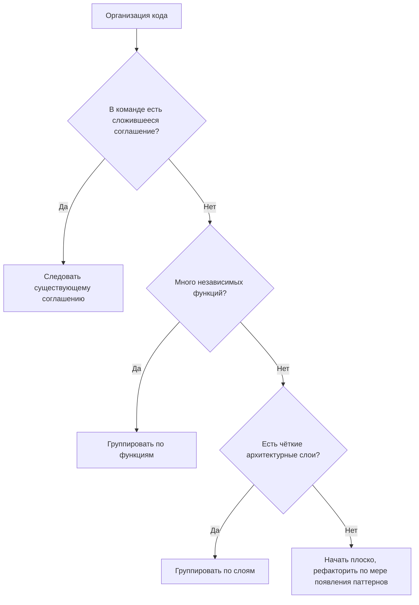

# Настройка разработки

Настройка готовит среду к реализации. Хорошо организованная настройка предотвращает путаницу и обеспечивает единообразные практики разработки.

---

## Подготовка среды

Прежде чем писать код, убедитесь, что среда разработки готова.

### Единообразие среды

Среды разработки должны быть воспроизводимыми:

- **Указывайте версии** — фиксируйте версии зависимостей, чтобы избежать проблемы «у меня на машине работает»
- **Документируйте шаги настройки** — новые разработчики должны уметь быстро всё настроить
- **Автоматизируйте, где возможно** — скрипты для типовых задач настройки сокращают ошибки
- **Изолируйте среды** — избегайте глобальных установок, которые могут конфликтовать

---

## Структура проекта

Организуйте код предсказуемо. Единообразная структура помогает разработчикам ориентироваться в незнакомых частях кодовой базы.

### Принципы структуры

**Группируйте по связности** — связанные файлы должны лежать вместе.

Связная группировка (по функциям):

```text
orders/
  order_service.py
  order_repository.py
  order_model.py
  order_test.py
```

Разрозненная группировка (по типам):

```text
services/order_service.py
repositories/order_repository.py
models/order_model.py
tests/order_test.py
```

Работать могут оба подхода. Выберите один и применяйте его последовательно.

**Отражайте архитектуру** — структура должна повторять архитектурные компоненты.

Если в архитектуре есть:

- Слой API
- Слой сервисов
- Слой данных

Структура может быть такой:

```text
api/
services/
data/
```

**Разделяйте ответственности** — разные задачи храните в разных местах.

```text
src/           — Код приложения
tests/         — Тестовый код
config/        — Файлы конфигурации
scripts/       — Вспомогательные скрипты
docs/          — Документация
```

### Выбор структуры



---

## Зависимости

Зависимости — это внешний код, на который опирается ваш проект.

### Управление зависимостями

**Объявляйте явно** — все зависимости должны быть перечислены в файле-манифесте.

Зависимости размещаются в:

- `package.json` (Node.js)
- `requirements.txt` или `pyproject.toml` (Python)
- `Gemfile` (Ruby)
- `go.mod` (Go)
- `Cargo.toml` (Rust)

**Фиксируйте версии** — указывайте точные версии или диапазоны версий.

- Точная: `library==2.1.0`
- Диапазон: `library>=2.1,<3.0`

Точные версии лучше воспроизводимы, но требуют ручных обновлений.
Диапазоны допускают автоматические обновления, но рискуют ломающими изменениями.

**Разделяйте dev и production** — инструменты разработки не должны быть зависимостями продакшена.

- Production: библиотека, которую вы используете для обработки запросов
- Development: линтер, тестовый фреймворк, инструменты сборки

---

## Конфигурация

Конфигурация отделяет значения, специфичные для окружения, от кода.

### Принципы конфигурации

**Выносите значения, зависящие от окружения** — URL баз данных, API-ключи и feature flags не должны быть зашиты в код.

**Используйте разумные значения по умолчанию** — код должен работать с минимальной конфигурацией в разработке.

**Падайте явно при отсутствии обязательной конфигурации** — если конфигурация обязательна, проверяйте её при запуске и падайте с понятным сообщением.

**Отделяйте секреты от конфигурации** — секреты требуют дополнительной защиты.

### Подходы к конфигурации

**Переменные окружения** — просто, широко поддерживается, безопасно для секретов.

```text
DATABASE_URL=postgres://localhost/myapp
API_KEY=secret_key_here
DEBUG=true
```

**Файлы конфигурации** — хороши для сложной структурированной конфигурации.

```text
config/
  default.yaml     — Значения по умолчанию для всех окружений
  development.yaml — Переопределения для разработки
  production.yaml  — Переопределения для продакшена
```

**Конфигурация в коде** — когда конфигурация сама является кодом (маршруты, middleware).

- Конфигурация загружается при запуске, а не разбросана по кодовой базе.

### Чек-лист конфигурации

- [ ] Все значения, специфичные для окружения, вынесены
- [ ] Подход к конфигурации задокументирован
- [ ] Для разработки существуют значения по умолчанию
- [ ] Обязательная конфигурация проверяется при запуске
- [ ] Секреты обрабатываются безопасно (не хранятся в системе контроля версий)
- [ ] Конфигурацию можно переопределять для каждого окружения

---

## Начальный каркас проекта

При старте нового проекта установите структуру на раннем этапе.

### Чек-лист каркаса

- [ ] Структура каталогов создана
- [ ] Манифест зависимостей инициализирован
- [ ] Подход к конфигурации определён
- [ ] Скрипты сборки/запуска определены
- [ ] Тестовая инфраструктура настроена
- [ ] Система контроля версий инициализирована
- [ ] Существует README с инструкциями по настройке
- [ ] Конвейер CI/CD настроен (если применимо)

### Подход к каркасу

**Минимальная жизнеспособная структура** — начните с того, что нужно сейчас.

```text
project/
  src/           — Здесь код
  tests/         — Здесь тесты
  README.md      — Как настроить и запустить
  .gitignore     — Что не отслеживать
  [манифест зависимостей]
```

**Растите по необходимости** — добавляйте структуру, когда этого требует сложность.

- Не создавайте: `src/modules/feature_a/submodule_1/`
- Пока у вас нет: *нескольких функций, которые нуждаются в организации*

---

## Проверка настройки

После настройки убедитесь, что всё работает.

### Шаги проверки

1. Чистая копия: клонируйте репозиторий заново
2. Следуйте инструкциям по настройке: выполните задокументированные шаги
3. Запустите приложение: запустите его локально
4. Запустите тесты: выполните набор тестов
5. Внесите изменение: отредактируйте код, увидьте отражение изменения
6. Закоммитьте: убедитесь, что контроль версий работает

Если какой-либо шаг не удался, исправьте настройку и обновите документацию.

---

## Типичные ошибки настройки

**Недокументированные шаги** — для настройки нужны знания, которых нет в документации. Решение: документируйте каждый шаг.

**Глобальные зависимости** — для настройки нужны глобально установленные инструменты без указания версий. Решение: используйте инструменты на уровне проекта с зафиксированными версиями.

**Устаревшие инструкции** — документация описывает устаревшую настройку. Решение: проверяйте инструкции при внесении изменений.

**Сложная настройка** — настройка требует множества ручных шагов. Решение: автоматизируйте типовые задачи настройки.

**Отсутствие проверки** — нет способа узнать, сработала ли настройка. Решение: включите шаг проверки «hello world».

---

## После настройки

Когда настройка завершена:

1. Проверьте, что среда работает сквозным образом
2. Задокументируйте любые отклонения или встреченные проблемы
3. Переходите к реализации, следуя стандартам кодирования
4. Поддерживайте документацию по настройке в актуальном состоянии по мере развития проекта

Хорошая настройка незаметна: разработчики могут начать работать без трения.
