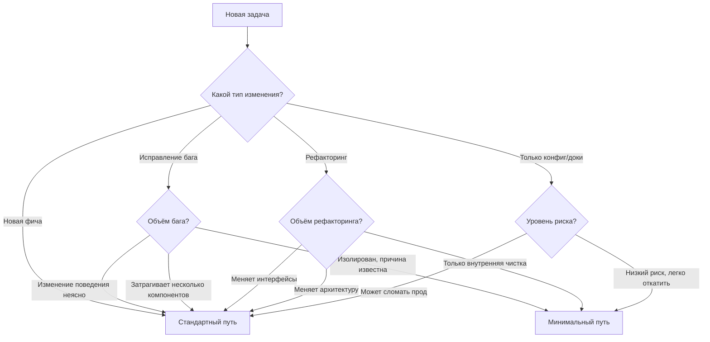

# Рабочие пути

Не всякая работа требует одного и того же уровня формальности. Этот документ определяет разные пути прохождения через DLP в зависимости от объёма и риска работы.

---

## Краткая справка

| Путь | Когда использовать | Необходимые фазы | Необходимая документация |
| --- | --- | --- | --- |
| Стандартный | Новые фичи, значимые изменения | Все четыре фазы | Полный набор артефактов |
| Минимальный | Небольшие исправления багов, мелочи | РАЗРАБОТКА → ТЕСТИРОВАНИЕ (в сжатом виде) | Только сообщение коммита |

---

## Выбор пути

Перед началом работы определите, какой путь применим.

### Дерево решений



---

## Минимальный путь

Минимальный путь предназначен для небольших, хорошо понятных изменений, где полная формальность добавляет трение без пользы.

### Чек-лист соответствия

Для использования Минимального пути должны выполняться ВСЕ следующие условия:

- [ ] **Изолированное изменение** — затрагивает один компонент или небольшой связанный набор файлов
- [ ] **Известна первопричина** — вы точно понимаете, почему возникает баг
- [ ] **Исправление очевидно** — решение прямолинейно, проектные решения не нужны
- [ ] **Низкий риск** — изменение не может вызвать каскадные сбои или потерю данных
- [ ] **Легко обратимо** — можно откатить без осложнений
- [ ] **Нет новых интерфейсов** — не добавляет и не меняет публичные API, контракты или схемы
- [ ] **Есть тестовое покрытие** — тесты существуют или их можно тривиально добавить

Если НЕ выполняется ЛЮБОЙ критерий, используйте Стандартный путь.

### Процесс Минимального пути

#### 1. Подтвердите соответствие

Сформулируйте, почему это изменение подходит:

Соответствие Минимальному пути:

- Изолированность: затрагивает только [компонент/файл]
- Первопричина: [краткое объяснение]
- Исправление: [описание в одну строку]
- Риск: низкий — [почему]
- Обратимость: да — обычный откат
- Интерфейсы: без изменений
- Тесты: [существующие / будут добавлены]

#### 2. Реализуйте и протестируйте

Следуйте основному циклу реализации из `development/implementation-workflow.md`:

1. Поймите баг (воспроизведите его)
2. Реализуйте исправление
3. Проверьте, что исправление работает
4. Убедитесь, что существующие тесты проходят
5. Добавьте тест, если этот случай ничем не покрыт
6. Закоммитьте с понятным сообщением

#### 3. Требования к сообщению коммита

Даже на Минимальном пути сообщения коммитов должны быть понятными:

```text
[Краткое описание того, что исправлено]

Root cause: [Что вызвало баг]
Fix: [Что делает изменение]
Test: [Как это проверено]
```

#### 4. Чек-лист завершения

- [ ] Баг исправлен (проверено вручную или тестом)
- [ ] Нет регрессий (существующие тесты проходят)
- [ ] Новый тест добавлен, если был пробел в покрытии
- [ ] Сообщение коммита документирует исправление

---

## Стандартный путь

Стандартный путь — это полный процесс DLP для значимой работы.

### Когда использовать

Используйте Стандартный путь для:

- Новых фич любого размера
- Исправлений багов с неясным объёмом или неясной первопричиной
- Изменений, затрагивающих несколько компонентов
- Изменений публичных интерфейсов или схем данных
- Работы, требующей проектных решений
- Всего, что несёт нетривиальный риск

### Процесс Стандартного пути

Следуйте полной последовательности фаз:

1. **ТРЕБОВАНИЯ** — определите, что нужно изменить и зачем
2. **ПРОЕКТИРОВАНИЕ** — спланируйте, как реализовать изменение
3. **РАЗРАБОТКА** — создайте решение
4. **ТЕСТИРОВАНИЕ** — проверьте, что оно работает корректно

Полные требования к фазам и критерии выхода см. в `AGENTS.md`.

---

## Эскалация пути

Если во время работы по Минимальному пути вы обнаруживаете, что:

- первопричина отличается от ожидаемой
- для исправления нужны проектные решения
- затронуто несколько компонентов
- риск выше, чем предполагалось

**Остановитесь и перейдите на Стандартный путь.**

Заявите:

```text
> "[Агент]: Эскалация с МИНИМАЛЬНОГО ПУТИ на СТАНДАРТНЫЙ ПУТЬ.
> Причина: [Почему Минимальный путь больше не подходит]"
```

Затем начните с подходящей фазы (обычно ТРЕБОВАНИЯ или ПРОЕКТИРОВАНИЕ).

---

## Примеры

### Примеры Минимального пути

**Подходит:**

- Исправление опечатки в сообщении об ошибке валидации
- Исправление ошибки на единицу в цикле с чётко падающим тестом
- Исправление проверки на null, из-за которой происходит падение в конкретном крайнем случае
- Обновление зашитого в коде значения, которое должно быть другим
- Исправление CSS, из-за которого есть смещение на конкретном размере экрана

**НЕ подходит:**

- Исправление «бага», который на самом деле может быть задуманным поведением
- Исправление состояния гонки (требует понимания проекта конкурентности)
- Исправление бага добавлением нового параметра в публичный API
- Исправление бага, который проявляется в нескольких местах (может потребоваться рефакторинг)
- Исправление бага, когда вы не уверены, почему исправление работает

### Примеры Стандартного пути

- Добавление нового эндпоинта API
- Реализация нового feature flag
- Рефакторинг процесса аутентификации
- Изменение схемы базы данных
- Исправление бага, требующее понимания архитектуры
- Любое изменение, которое пользователь явно хочет сначала спроектировать

---

## Антипаттерны

### Принудительный Минимальный путь

**Проблема:** использование Минимального пути, чтобы избежать документации, а затем обнаружение сложности посреди реализации.

**Симптом:** «быстрое исправление» превращается в часы отладки и несколько попыток.

**Профилактика:** будьте честны с критериями соответствия. В сомнении используйте Стандартный путь.

### Переусложнение мелких исправлений

**Проблема:** использование Стандартного пути для тривиальных изменений, создающее документационные накладные расходы без пользы.

**Симптом:** час уходит на документирование исправления опечатки в одну строку.

**Профилактика:** если все критерии Минимального пути явно выполнены, используйте его.

### Расползание объёма на Минимальном пути

**Проблема:** начав с небольшого исправления, вы раз за разом добавляете «ещё одну мелочь».

**Симптом:** работа по Минимальному пути вырастает в фичу без нормального проектирования.

**Профилактика:** если объём расширяется, остановитесь и эскалируйте. Новый объём требует новой оценки пути.
