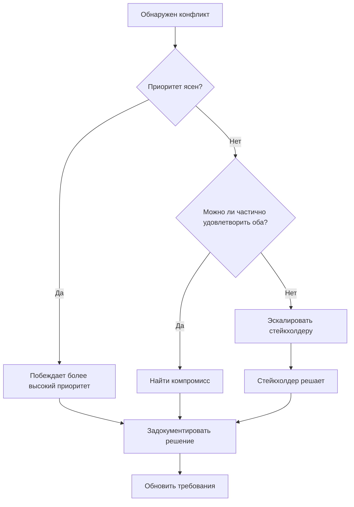

# Анализ требований

Анализ превращает сырую собранную информацию в структурированные, пригодные для действий требования. На этой фазе обрабатывается то, что собрано, выявляются пробелы, разрешаются конфликты и расставляются приоритеты.

---

## Процесс анализа

Анализ — это не пассивное чтение, а активный допрос собранной информации.

### Что даёт анализ

- Неявные требования становятся явными
- Конфликты выявлены и разрешены
- Требования ранжированы по важности
- Границы объёма уточнены
- Зависимости между требованиями нанесены на карту

### Настрой аналитика

Подходите к собранной информации с конструктивным скептицизмом:

- Что сказано явно?
- Что подразумевается, но не сказано?
- Чего не хватает?
- Что противоречит чему-то другому?
- Что от чего зависит?

---

## Выявление неявных требований

Стейкхолдеры часто опускают требования, которые считают очевидными. Ваша задача — вывести их на поверхность.

### Категории неявных требований

**Подразумеваемая функциональность** — функции, настолько ожидаемые, что о них не говорят.

```text
Заявлено: "Пользователи должны иметь возможность создавать аккаунты"
Неявно:
  - Пользователи должны иметь возможность входить после создания аккаунта
  - Пользователи должны иметь возможность выходить
  - Пользователи должны иметь возможность восстановить забытый пароль
  - Пользователи не должны иметь возможность создавать дубликаты аккаунтов
```

**Обработка ошибок** — что происходит, когда что-то идёт не так, редко оговаривают заранее.

```text
Заявлено: "Система должна обрабатывать платежи"
Неявно:
  - Что происходит, если платёж не прошёл?
  - Что происходит, если истёк тайм-аут платежа?
  - Что происходит, если платёж отклонён?
  - Как пользователя уведомляют о статусе платежа?
```

**Нефункциональные требования** — качества, которыми система должна обладать помимо функций.

- Производительность: как быстро она должна отвечать?
- Безопасность: что нужно защищать?
- Надёжность: какая доступность ожидается?
- Масштабируемость: сколько пользователей и запросов она должна выдерживать?

**Крайние случаи** — граничные условия и необычные сценарии.

- Пустые состояния (нет данных, первый пользователь, нет результатов)
- Максимальные пределы (сколько элементов, насколько большие)
- Параллельные действия (два пользователя редактируют одно и то же)
- Переходы состояний (что происходит во время обработки)

### Как вывести неявные требования

Для каждого явного требования спросите:

1. Что должно быть истинным до того, как это может произойти?
2. Что должно произойти после завершения?
3. Что может пойти не так по ходу?
4. Какие существуют вариации?
5. Что, по мнению пользователей, должно произойти?

---

## Обнаружение конфликтов

Собранные требования могут противоречить друг другу. Конфликты нужно разрешить до продолжения.

### Типы конфликтов

**Прямое противоречие** — два требования нельзя выполнить одновременно.

```text
Требование A: "Все действия должны логироваться для аудита"
Требование B: "Система не должна хранить никаких данных об активности пользователей"
```

**Конфликт ресурсов** — требования конкурируют за ограниченные ресурсы.

```text
Требование A: "Система должна отвечать за 100 мс"
Требование B: "Система должна анализировать всю историю данных для рекомендаций"
```

**Конфликт объёма** — стейкхолдеры расходятся во мнении о том, что входит.

```text
Стейкхолдер A: "Поддержка мобильных устройств необходима к запуску"
Стейкхолдер B: "Мобильную версию можно отложить до второй фазы"
```

### Разрешение конфликтов



При документировании разрешения конфликта:

```text
КОНФЛИКТ: аудит-логирование и минимизация данных
Решение: логировать действия, но анонимизировать идентификаторы пользователей через 30 дней
Решил: владелец продукта, 2024-01-15
Компромисс: меньше деталей аудита для старых записей
```

---

## Приоритизация

Не все требования одинаково важны. Приоритизация подсказывает, что строить первым и что вырезать, если понадобится.

### Категории приоритета

**Must-have (обязательно)** — без этого решение нежизнеспособно. Без обсуждений.

**Should-have (желательно)** — важно, но не критично. Решение работает и без этого, хотя хуже.

**Nice-to-have (было бы неплохо)** — желательно, если хватит времени. Первое, что вырезают под давлением.

**Won't-have (в этот раз нет)** — явно отложено. Документирование таких пунктов не даёт объёму расползаться.

### Критерии приоритизации

При назначении приоритета учитывайте:

- **Ценность** — насколько это вносит вклад в решение основной проблемы?
- **Риск** — насколько вероятны проблемы, если этого не будет или оно будет сделано плохо?
- **Зависимости** — что ещё требует, чтобы это существовало сначала?
- **Стоимость** — сколько усилий требуется относительно ценности?

### Чек-лист приоритизации

- [ ] У каждого требования назначен приоритет
- [ ] Обязательные требования действительно необходимы
- [ ] Желательные и «неплохо бы» различены
- [ ] Отложенные пункты явно задокументированы
- [ ] Стейкхолдеры согласны с приоритизацией
- [ ] Зависимости соблюдают порядок приоритетов (зависимости обязательных требований тоже обязательны)

---

## Определение границ объёма

Объём определяет, что внутри, а что снаружи. Чёткие границы не дают объёму расползаться и задают реалистичные ожидания.

### Документирование объёма

**В объёме:**

- Явный список того, что будет поставлено
- Границы функциональности (что она будет делать)
- Среды, в которых она будет работать
- Пользователи, которым она будет служить

**Вне объёма:**

- Явный список того, что не будет поставлено
- Связанные функции, отложенные на потом
- Не поддерживаемые платформы или среды
- Типы пользователей, которым она не служит

**Границы объёма:**

- Где заканчивается эта функция и начинается другая
- Точки интеграции с другими системами
- Точки передачи в ручные процессы

### Протокол изменения объёма

Когда изменения объёма предлагаются после анализа:

1. Задокументируйте предлагаемое изменение
2. Оцените влияние на существующие требования
3. Определите, что нужно добавить, изменить или удалить
4. Оцените влияние на сроки и ресурсы
5. Получите явное одобрение, прежде чем включать

---

## Карта зависимостей

Требования часто зависят друг от друга. Понимание зависимостей влияет на приоритизацию и порядок реализации.

### Типы зависимостей

**Функциональная зависимость** — одно требование не может работать без другого.

```text
"Пользователи могут фильтровать результаты поиска" зависит от "Пользователи могут искать"
```

**Зависимость по данным** — одному требованию нужны данные, которые порождает другое.

```text
"Формировать ежемесячные отчёты" зависит от "Записывать ежедневные транзакции"
```

**Логическая зависимость** — одно требование имеет смысл только после существования другого.

```text
"Пользователи могут делиться сохранёнными элементами" зависит от "Пользователи могут сохранять элементы"
```

### Документирование зависимостей

Создайте простую карту зависимостей:

```text
Требование: Поиск пользователей
  Нужно для: Фильтров поиска, Истории поиска, Подсказок поиска

Требование: Аккаунты пользователей
  Нужно для: Сохранённых поисков, Настроек пользователя, Истории покупок
  Требует: Системы подтверждения email
```

---

## Результат анализа

К концу анализа у вас должны быть:

**Уточнённый список требований** — все собранные требования, приведённые в порядок и дополненные неявными.

**Журнал разрешения конфликтов** — найденные конфликты и то, как они разрешены.

**Приоритизированный бэклог** — требования, упорядоченные по важности, с чёткими пометками must-have / should-have / nice-to-have.

**Документ об объёме** — чёткие определения «в объёме», «вне объёма» и границ.

**Карта зависимостей** — связи между требованиями, влияющие на порядок реализации. По возможности добавьте диаграмму Mermaid.

**Реестр рисков** — требования с высоким риском, неопределённые или те, к которым, возможно, придётся вернуться.

---

## Чек-лист анализа

- [ ] Все собранные требования обработаны
- [ ] Неявные требования выявлены
- [ ] Конфликты выявлены и разрешены
- [ ] Требования приоритизированы
- [ ] Границы объёма чёткие
- [ ] Зависимости нанесены на карту
- [ ] Высокорисковые пункты помечены
- [ ] Готово к переходу к спецификации

---

## Переход к спецификации

Переходите к спецификации, когда:

- Анализ стабилизировался (новых открытий мало)
- Конфликты разрешены
- Приоритеты назначены
- Объём ясен
- Достаточно ясности, чтобы писать точные утверждения

Спецификация дополнительно уточнит и формализует то, что получено в ходе анализа.
