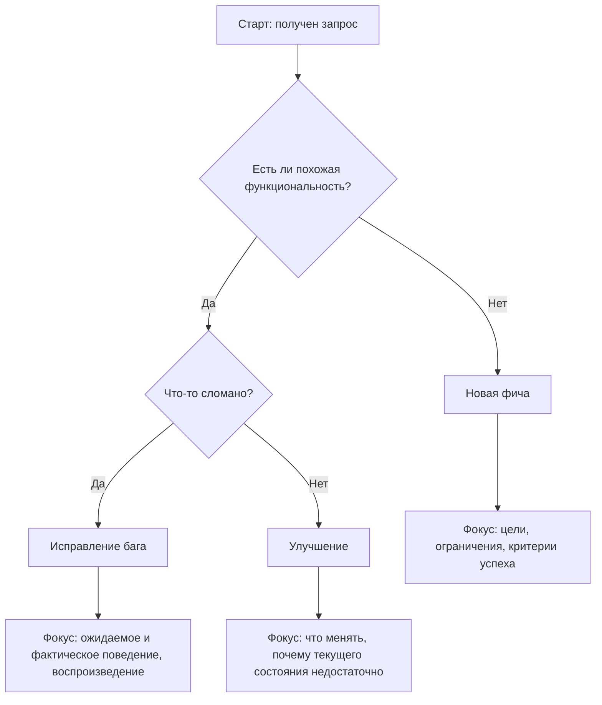
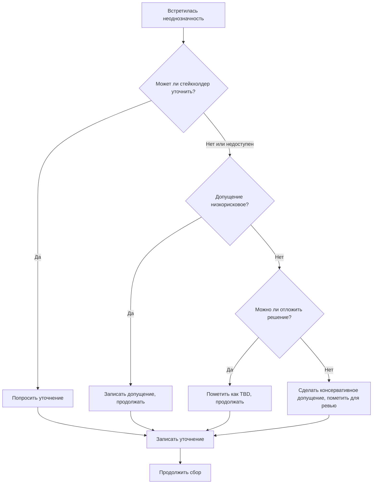

# Сбор требований

Сбор требований — это извлечение информации из источников (людей, документов, существующих систем), чтобы понять, что нужно построить. Цель — собрать достаточно информации, чтобы двигаться дальше, а не добиться идеального понимания с первой попытки.

---

## Источники требований

Требования приходят из нескольких источников, у каждого свои особенности:

**Стейкхолдеры** — люди, которые хотят это ПО или будут им пользоваться. Они знают, какие у них проблемы, но могут не знать, какие решения возможны.

**Существующие системы** — текущее ПО, ручные процессы и обходные приёмы показывают реальные потребности и болевые точки.

**Документация** — спецификации, руководства пользователя, тикеты поддержки и запросы на функции из предыдущих работ.

**Знание предметной области** — отраслевые стандарты, регуляции и распространённые практики, которые применимы независимо от того, что упомянули стейкхолдеры.

---

## Классификация запроса

Прежде чем собирать детали, поймите, с каким видом работы вы имеете дело.

**Новая фича (New Feature)** — того, чего не существует. Нужно понять цели, ограничения и то, как выглядит успех.

**Исправление бага (Bug Fix)** — нечто существует, но работает неправильно. Нужно понять ожидаемое поведение, фактическое поведение и шаги воспроизведения.

**Улучшение (Enhancement)** — нечто существует и работает, но требует доработки. Нужно понять, что менять и почему текущего состояния недостаточно.

---

## Вопросы, которые стоит задавать

Эффективный сбор зависит от правильных вопросов. Разные типы вопросов служат разным целям.

### Вопросы о целях

Поймите лежащую в основе потребность, а не только заявленный запрос.

- Какую проблему вы пытаетесь решить?
- Что произойдёт, если эту проблему не решить?
- Как выглядит успех?
- Кому выгодно, чтобы это было построено?
- Почему именно сейчас?

### Вопросы об объёме

Определите границы работы.

- Какой минимум был бы полезен?
- Что явно не входит?
- Есть ли связанные функции, которые должны подождать?
- Какая существующая функциональность должна остаться без изменений?

### Вопросы о контексте

Поймите среду и ограничения.

- Кто будет этим пользоваться? В каких ситуациях?
- С какими системами это должно работать?
- Есть ли требования к производительности или безопасности?
- Какие существуют ограничения (время, бюджет, технологии)?
- Что уже пробовали раньше?

### Вопросы о деталях

Зафиксируйте конкретное поведение и крайние случаи.

- Какие входные данные ожидаются?
- Какие выходные данные должны получаться?
- Что происходит, когда что-то идёт не так?
- Есть ли вариации или особые случаи?
- Что происходит на границах (пусто, максимум, минимум)?

### Вопросы для проверки

Подтвердите понимание, прежде чем двигаться дальше.

- Позвольте резюмировать, как я понял, — это верно?
- Что покажет, что это работает?
- Как вы поймёте, что проблема решена?

---

## Работа с неоднозначностью

Неоднозначность на ранних этапах требований — норма. Вопрос в том, как её разрешать.

### Когда спрашивать

Просите уточнение, когда:

- Неоднозначность затрагивает основную функциональность
- Разные трактовки ведут к существенно разным реализациям
- У вас нет оснований для разумного допущения
- Ошибка была бы дорогой

### Когда допускать

Делайте задокументированные допущения, когда:

- Стейкхолдер недоступен, а двигаться нужно
- Неоднозначность незначительна и её легко поправить позже
- Знание предметной области даёт разумное значение по умолчанию
- Допущение можно проверить во время валидации

### Как документировать неоднозначность

Когда неоднозначность нельзя разрешить сразу:

1. ДОПУЩЕНИЕ: адреса электронной почты пользователей будут уникальными во всей системе.
2. Основание: стандартная практика для систем с учётными записями.
3. Риск, если это неверно: средний — потребуется изменение схемы.
4. Как проверить: подтвердить у стейкхолдера до фазы проектирования.

---

## Чек-лист сбора

Используйте этот чек-лист, чтобы обеспечить исчерпывающий сбор:

- [ ] Постановка проблемы понятна
- [ ] Критерии успеха определены
- [ ] Стейкхолдеры определены
- [ ] Границы объёма обсуждены
- [ ] Точки интеграции известны
- [ ] Ограничения задокументированы
- [ ] Счастливый путь описан
- [ ] Сценарии ошибок рассмотрены
- [ ] Крайние случаи изучены
- [ ] Допущения задокументированы
- [ ] Нерешённые вопросы перечислены

---

## Результат сессии сбора

К концу сбора вы должны уметь подготовить:

**Постановку проблемы** — одно-два предложения о том, какая проблема решается и для кого.

**Цели** — чего должно достичь решение, сформулированные через результаты, а не через реализацию.

**Ограничения** — неизменные рамки, в которых решение должно работать.

**Объём** — что входит и что явно исключено.

**Начальные требования** — черновые формулировки того, что система должна делать, готовые к анализу и уточнению.

**Открытые вопросы** — неоднозначности или неопределённости, требующие разрешения.

**Допущения** — решения, принятые без явного подтверждения и помеченные для валидации.

---

## Типичные ошибки при сборе

**Прыжок к решениям** — вы собираете требования, а не проектируете решения. Фиксируйте, что нужно, а не как это построить.

**Буквальное понимание запросов** — заявленный запрос может не отражать лежащую в основе потребность. Копайте глубже вопросами о целях.

**Игнорирование ограничений** — ограничения тоже являются требованиями. Решение, игнорирующее ограничения, нельзя считать допустимым.

**Сбор в изоляции** — у разных стейкхолдеров могут быть конфликтующие или дополняющие взгляды. Убедитесь, что учтены все точки зрения.

**Слишком ранняя остановка** — если у вас нет открытых вопросов, возможно, вы задали их недостаточно. Некоторая неоднозначность ожидаема; полное её отсутствие подозрительно.

---

## Переход к анализу

Переходите к анализу, когда:

- У вас есть чёткая постановка проблемы
- Основные цели понятны
- Границы объёма намечены
- У вас есть материал для анализа (а не только открытые вопросы)
- Продолжение сбора даёт убывающую отдачу

Анализ выявит пробелы, из-за которых, возможно, придётся вернуться к сбору.
