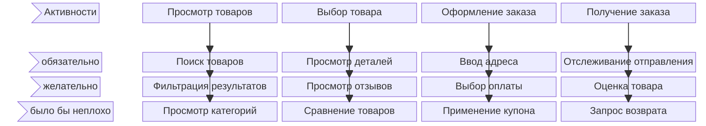
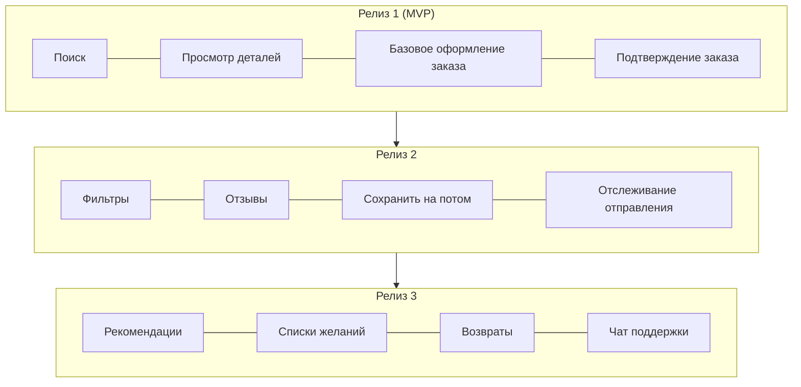
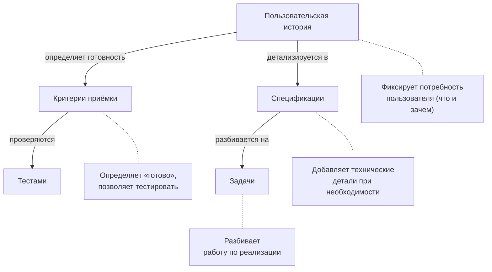

# Пользовательские истории

Пользовательские истории фиксируют требования с точки зрения пользователя. Они описывают, чего человек хочет добиться и зачем, не указывая, как это реализовывать.

---

## Что такое пользовательская история

Пользовательская история — это короткое неформальное описание функции, рассказанное с точки зрения того, кто её хочет. Истории сосредоточены на ценности для пользователей, а не на технической реализации.

### Стандартный формат

**ВАЖНО: используйте блоки кода**

```text
Как [тип пользователя]
Я хочу [некоторая цель]
Чтобы [некоторая причина/выгода]
```

**Как** — определяет, кто хочет эту возможность. Будьте конкретны в роли.

**Я хочу** — описывает цель или действие. Фокус на «что», а не на «как».

**Чтобы** — объясняет выгоду или ценность. Часто это самая важная часть.

### Примеры историй

```text
Как зарегистрированный покупатель
Я хочу сохранять товары в список желаний
Чтобы купить их позже, не ища заново

Как управляющий магазином
Я хочу видеть ежедневные сводки продаж
Чтобы отслеживать результаты без ручного формирования отчётов

Как новый посетитель
Я хочу просматривать товары без создания аккаунта
Чтобы оценить магазин, прежде чем оставлять свои данные
```

### Почему важен формат

Формат заставляет думать о:

- **Кто** выигрывает (не все пользователи одинаковы)
- **Что** им нужно (сама возможность)
- **Зачем** им это нужно (решаемая базовая проблема)

**Часть «чтобы» часто раскрывает настоящее требование. Если вы не можете объяснить, зачем, возможно, вы не понимаете потребность.**

---

## Как писать эффективные истории

### Критерии INVEST

Хорошие пользовательские истории следуют принципам INVEST:

**Independent (независимые)** — истории можно разрабатывать в любом порядке. Минимизируйте зависимости между историями.

```text
Зависимые (проблематично):
  История A: Пользователь может создать аккаунт
  История B: Пользователь может подтвердить email (требует A)
  История C: Пользователь может войти (требует A и B)

Более независимые:
  История A: Пользователь может создать аккаунт и входить по паролю
  История B: Пользователь может добавить подтверждение email к своему аккаунту
  История C: Пользователь может включить двухфакторную аутентификацию

Каждая даёт ценность сама по себе.
```

**Negotiable (обсуждаемые)** — истории не являются контрактами. Детали обсуждаются и уточняются по ходу разработки.

```text
Слишком жёстко:
  "Отображать ровно 10 товаров на странице в сетке 2x5 с
   отступами 12px и синими рамками"

Обсуждаемо:
  "Как покупатель, я хочу просматривать товары постранично,
   чтобы меня не перегружало слишком много вариантов"

  Детали реализации обсуждаются, когда начинается работа.
```

**Valuable (ценные)** — каждая история даёт ценность пользователям или бизнесу. Никаких чисто технических задач.

```text
Не ценно для пользователей:
  "Рефакторинг слоя базы данных"
  "Обновить зависимости"

Ценно:
  "Как пользователь, я хочу получать результаты поиска быстрее чем за 2 секунды,
   чтобы не терять терпение во время покупок"

  (Может потребовать оптимизации базы данных, но сформулировано как ценность для пользователя)
```

**Estimable (оцениваемые)** — команда может примерно оценить трудозатраты. Если нет, историю нужно уточнить или разделить.

```text
Не оценивается:
  "Улучшить производительность системы"
  (Слишком расплывчато для оценки)

Оценивается:
  "Как пользователь, я хочу, чтобы главная страница загружалась быстрее чем за 3 секунды"
  (Понятный объём, можно оценить трудозатраты)
```

**Small (небольшие)** — историю должно быть возможно завершить за короткое время (обычно в рамках одной итерации/спринта).

```text
Слишком большая:
  "Как пользователь, я хочу управлять всем своим профилем"

Меньше:
  "Как пользователь, я хочу изменить своё отображаемое имя"
  "Как пользователь, я хочу сменить фото профиля"
  "Как пользователь, я хочу задать настройки уведомлений"
```

**Testable (проверяемые)** — существуют ясные критерии, по которым можно проверить, что история завершена.

```text
Не проверяется:
  "Как пользователь, я хочу, чтобы приложение было интуитивным"

Проверяется:
  "Как новый пользователь, я хочу оформить заказ, не читая
   инструкций, чтобы быстро купить"

  Тест: может ли новый пользователь совершить покупку без помощи?
```

---

## Карта историй (Story Mapping)

Карта историй — техника организации пользовательских историй в наглядную карту, показывающую общую картину продукта или функции.

### Структура карты



«Хребет» (верхняя строка) показывает активности в пути пользователя слева направо. Под каждой активностью «висят» истории, упорядоченные по приоритету (обязательные сверху, «неплохо бы» снизу).

### Как построить карту историй

**Шаг 1: определите хребет**

Перечислите основные активности пользователей по порядку. Они образуют горизонтальную ось.

```text
Пример для интернет-магазина:
  Обнаружение → Просмотр → Выбор → Покупка → Получение → Поддержка
```

**Шаг 2: добавьте пользовательские задачи**

Под каждой активностью перечислите конкретные действия пользователей. Упорядочите по приоритету (самое важное сверху).

```text
Под "Просмотр":
  - Поиск по ключевому слову
  - Фильтр по категории
  - Сортировка по цене
  - Просмотр товаров со скидкой
```

**Шаг 3: нарежьте релизы**

Проведите горизонтальные линии, чтобы сгруппировать истории в релизы. Каждый срез должен быть пригодным к использованию продуктом.



### Преимущества карты историй

- **Видно целое** — отдельные истории в контексте всего пути пользователя
- **Находит пробелы** — недостающие шаги становятся видны
- **Позволяет приоритизировать** — можно сравнивать истории по всему пути
- **Определяет MVP** — проведите линию для минимально жизнеспособных срезов
- **Доносит объём** — стейкхолдеры видят, что входит, а что нет

---

## Разделение больших историй

Большие истории (эпики) нужно делить на более мелкие поставляемые части. Делите так, чтобы сохранялась ценность для пользователя.

### Стратегии разделения

**По шагам рабочего процесса**

Эпик: «Пользователь может купить товар»

Делим на:

- Пользователь может добавить товар в корзину
- Пользователь может просматривать и изменять корзину
- Пользователь может ввести адрес доставки
- Пользователь может ввести платёжные данные
- Пользователь может подтвердить и разместить заказ

**По вариациям бизнес-правил**

Эпик: «Рассчитать стоимость доставки»

Делим на:

- Рассчитать доставку по фиксированному тарифу
- Рассчитать доставку по весу
- Рассчитать варианты срочной доставки
- Применить бесплатную доставку для заказов свыше $50

**По типу данных или вариации**

Эпик: «Пользователь может импортировать контакты»

Делим на:

- Импорт контактов из CSV-файла
- Импорт контактов из Google
- Импорт контактов из Outlook

**По роли пользователя**

Эпик: «Управление складскими запасами»

Делим на:

- Сотрудник склада может обновлять остатки
- Менеджер может задавать пороги пополнения
- Администратор может настраивать расположения складов

**По интерфейсу**

Эпик: «Пользователь может пользоваться аккаунтом на мобильном устройстве»

Делим на:

- Просмотр сводки аккаунта в мобильной веб-версии
- Оптимизированный мобильный процесс оформления заказа
- Мобильные push-уведомления об обновлениях заказа

**По операции (CRUD)**

Эпик: «Управление сохранёнными адресами»

Делим на:

- Пользователь может добавить новый адрес
- Пользователь может просмотреть сохранённые адреса
- Пользователь может изменить существующий адрес
- Пользователь может удалить адрес
- Пользователь может задать адрес по умолчанию

### Антипаттерны разделения

Избегайте разделений, которые не дают ценности по отдельности:

Плохое разделение (технические слои):

- Построить схему базы данных для заказов
- Построить API для заказов
- Построить UI для заказов

Ни одно не даёт ценности, пока не завершены все.

Лучшее разделение (вертикальные срезы):

- Пользователь может разместить простой заказ (один товар, параметры по умолчанию)
- Пользователь может заказать несколько товаров
- Пользователь может выбрать скорость доставки
- Пользователь может применить промокоды

Каждое даёт сквозную ценность.

---

## Критерии приёмки для историй

Каждой пользовательской истории нужны критерии приёмки, определяющие, когда она завершена.

### Как писать критерии приёмки

Используйте конкретные, проверяемые условия:

```text
История: Как покупатель, я хочу искать товары по названию,
         чтобы быстро находить то, что мне нужно

Критерии приёмки:
- Поле поиска видно на всех страницах
- Ввод текста и нажатие Enter показывает результаты
- Результаты показывают товары с подходящими названиями
- Поиск нечувствителен к регистру
- Результаты появляются в течение 2 секунд
- Сообщение "Ничего не найдено" отображается, когда ничего не подходит
- Частичные совпадения включены (поиск "shirt" находит "t-shirt")
```

### Формат Given-When-Then

Для критериев, ориентированных на поведение:

```text
История: Как покупатель, я хочу добавлять товары в корзину,
         чтобы купить несколько товаров сразу

Критерии приёмки:

Given я просматриваю страницу товара
When я нажимаю "Добавить в корзину"
Then товар появляется в моей корзине
And значок корзины показывает обновлённое количество

Given в моей корзине есть товар
When я добавляю тот же товар ещё раз
Then количество увеличивается, а не дублируется

Given товара нет в наличии
When я просматриваю его страницу
Then кнопка "Добавить в корзину" отключена
And я вижу сообщение "Нет в наличии"
```

### Чек-лист критериев

Для каждой истории убедитесь, что критерии охватывают:

- [ ] Счастливый путь (основной успешный сценарий)
- [ ] Пустые/нулевые состояния
- [ ] Обработку ошибок
- [ ] Крайние случаи (лимиты, границы)
- [ ] Права доступа (кто может/не может)
- [ ] Ожидания по производительности (если актуально)

---

## Типичные ошибки в пользовательских историях

### Технические задачи в виде историй

Неверно (это не даёт ценности пользователю):

```text
Как разработчик,
Я хочу отрефакторить модуль авторизации,
Чтобы код был чище
```

Лучше:

```text
Как пользователь,
Я хочу оставаться в системе 30 дней,
Чтобы не входить при каждом посещении
```

Или не делайте это историей. Техническая работа может быть задачами, привязанными к настоящим пользовательским историям, или вестись отдельно.

### Пропуск части «чтобы»

```text
Неполно:
"Как пользователь, я хочу экспортировать свои данные"

Зачем? Соответствие требованиям? Резервная копия? Миграция? Анализ?

Полно:
"Как пользователь, я хочу экспортировать свои данные в CSV,
чтобы проанализировать свои расходы в электронной таблице"

Причина определяет реализацию.
```

### Слишком большие истории

Слишком большая: «Как пользователь, я хочу управлять своим аккаунтом»

Это эпик, содержащий много историй.

Подходящий размер:

- «Как пользователь, я хочу сменить пароль»
- «Как пользователь, я хочу обновить адрес электронной почты»
- «Как пользователь, я хочу включить двухфакторную аутентификацию»

### Детали реализации в истории

Слишком конкретно (это предписывает решение):

```text
"Как пользователь, я хочу нажать синюю кнопку в правом верхнем
углу, которая открывает модальное окно с формой, содержащей..."
```

Уместно (как — пусть решает проектирование):

```text
"Как пользователь, я хочу быстро связаться с поддержкой,
чтобы получить помощь по моему заказу"
```

### Забытые несчастливые пути

Неполно:

```text
"Как пользователь, я хочу загрузить своё резюме"

А как насчёт неверных файлов? Слишком больших? Неправильного формата? Сетевой ошибки?
```

Полно (с критериями приёмки):

```text
"Как пользователь, я хочу загрузить своё резюме"

Критерии:

- Принимает форматы PDF, DOC, DOCX
- Максимальный размер файла: 5 МБ
- Показывает прогресс во время загрузки
- Показывает ошибку, если формат неверный
- Показывает ошибку, если превышен размер
- Позволяет повторить, если загрузка не удалась
```

---

## Пользовательские истории в процессе

### Связь с другими артефактами требований



### Когда использовать пользовательские истории

Пользовательские истории хорошо подходят для:

- Разработки функций
- Пользовательской функциональности
- Итеративной/гибкой (agile) разработки
- Требований, которым полезно обсуждение

Пользовательские истории хуже подходят для:

- Сугубо технической инфраструктурной работы
- Требований соответствия нормам с точными спецификациями
- Исправлений багов (просто опишите баг)
- Простых изменений, не требующих обсуждения

---

## Чек-лист написания историй

Перед написанием:

- [ ] Определена конкретная роль пользователя
- [ ] Понята лежащая в основе потребность (а не только запрос)
- [ ] Подтверждено, что это даёт ценность пользователю или бизнесу

История:

- [ ] Следует формату «Как... Я хочу... Чтобы...»
- [ ] Независима (минимум зависимостей)
- [ ] Достаточно мала, чтобы завершить за одну итерацию
- [ ] Имеет чёткие критерии приёмки
- [ ] Охватывает случаи ошибок и крайние случаи

Карта историй:

- [ ] Истории организованы по пути пользователя
- [ ] Приоритеты ясны (обязательно и «неплохо бы»)
- [ ] Определён срез MVP
- [ ] Пробелы в пути выявлены
