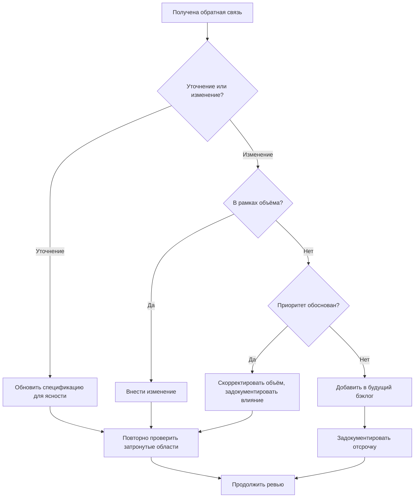

# Валидация требований

Валидация подтверждает, что спецификация верна, полна и готова к проектированию. Это последний контрольный пункт перед тем, как вкладывать значительные усилия в реализацию.

---

## Почему валидация важна

Ошибки, пойманные во время валидации, исправлять намного дешевле, чем ошибки, пойманные во время реализации или после релиза.

- Ошибки требований, найденные при проектировании: стоимость исправления X
- Ошибки требований, найденные при реализации: стоимость исправления 5–10X
- Ошибки требований, найденные после релиза: стоимость исправления 50–100X

Валидация — это не бюрократия, а снижение риска.

---

## Валидация и верификация

**Валидация (Validation)** — строим ли мы правильную вещь? Решает ли спецификация настоящую проблему?

**Верификация (Verification)** — строим ли мы вещь правильно? Соответствует ли реализация спецификации?

Этот документ посвящён валидации. Верификация происходит во время тестирования.

---

## Ревью со стейкхолдерами

Спецификации должны проходить ревью у стейкхолдеров, чтобы подтвердить соответствие реальным потребностям.

### Подготовка к ревью со стейкхолдерами

Перед презентацией стейкхолдерам:

1. Убедитесь, что спецификация в пригодном для ревью виде (а не черновик)
2. Подготовьте краткое изложение ключевых решений и компромиссов
3. Перечислите области, в которых у вас есть сомнения или низкая уверенность
4. Определите вопросы, требующие ответа от стейкхолдеров

### Проведение ревью

Во время ревью со стейкхолдерами:

- Проходите по требованиям на подходящем уровне детализации
- Подтверждайте понимание, а не только согласие
- Спрашивайте «Вы именно это имели в виду?», а не «Это нормально?»
- Обращайте внимание на колебания или замешательство
- Записывайте всю обратную связь, вопросы и опасения

### Вопросы для ревью

Спросите у стейкхолдеров:

- Решает ли это вашу исходную проблему?
- Чего-то не хватает из того, что вы ожидали увидеть?
- Есть ли что-то включённое, чего не должно быть?
- Верны ли приоритеты?
- Есть ли опасения по поводу того, что описано?
- Можете ли вы придумать сценарии, которые мы не рассмотрели?

### Обработка обратной связи по ревью

---

## Критерии качества

Требование проходит ревью качества, когда удовлетворяет этим критериям:

### Качество отдельного требования

**Атомарность (Atomic)** — требование описывает одну вещь, а не несколько, склеенных вместе.

- Плохо: «Пользователи могут создавать, редактировать и удалять посты, и у постов могут быть комментарии»
- Лучше: отдельные требования для CRUD постов и для функциональности комментариев

**Необходимость (Essential)** — требование необходимо; его удаление оставило бы пробел.

**Согласованность (Consistent)** — требование не конфликтует с другими требованиями.

**Однозначность (Unambiguous)** — возможна только одна трактовка.

**Проверяемость (Testable)** — существуют объективные критерии проверки выполнения.

**Прослеживаемость (Traceable)** — требование связано с заявленной потребностью.

### Качество спецификации

**Полнота (Complete)** — присутствуют все необходимые требования.

**Согласованность (Consistent)** — нет внутренних противоречий.

**Изменяемость (Modifiable)** — изменения можно вносить без масштабных переписываний.

**Приоритизированность (Prioritized)** — относительная важность ясна.

**Верифицируемость (Verifiable)** — спецификацию в целом можно проверить на валидность.

---

## Чек-лист валидации

Используйте этот чек-лист, прежде чем подписывать требования:

Полнота

- [ ] Все функции специфицированы
- [ ] Все случаи ошибок покрыты
- [ ] Все крайние случаи рассмотрены
- [ ] NFR включены
- [ ] Границы объёма ясны
- [ ] Не осталось пунктов TBD

Согласованность

- [ ] Нет противоречий между требованиями
- [ ] Терминология единообразна
- [ ] Приоритеты согласованы

Проверяемость

- [ ] У всех требований есть критерии приёмки
- [ ] Все критерии объективно проверяемы

Осуществимость

- [ ] Технический подход жизнеспособен
- [ ] Ограничения соблюдены
- [ ] Ресурсы доступны

Согласованность со стейкхолдерами

- [ ] Стейкхолдеры просмотрели спецификацию
- [ ] Обратная связь учтена
- [ ] Одобрение получено

---

## Когда валидация не пройдена

Если валидация выявляет проблемы:

### Недостающие требования

Вернитесь к сбору, чтобы собрать недостающую информацию, затем повторно проанализируйте и заново специфицируйте.

### Противоречия

Вернитесь к анализу, чтобы разрешить конфликты, затем обновите спецификацию.

### Неясные критерии

Доработайте конкретные требования в спецификации, добавив ясности.

### Несогласие стейкхолдеров

Вернитесь к сбору, чтобы понять разногласие, повторно проанализируйте приоритеты, обновите спецификацию.

### Сомнения в осуществимости

Скорректируйте объём или ограничения, вернитесь к анализу для пересмотра приоритетов.

---

## Переход к проектированию

Когда валидация пройдена:

1. Заархивируйте утверждённую спецификацию
2. Используйте её как авторитетный источник для проектирования
3. Относитесь к изменениям как к изменениям объёма, требующим повторной валидации
4. Начинайте фазу проектирования

Теперь спецификация служит контрактом на то, что будет построено. Изменения возможны, но должны проходить через контроль изменений, чтобы сохранять целостность.
