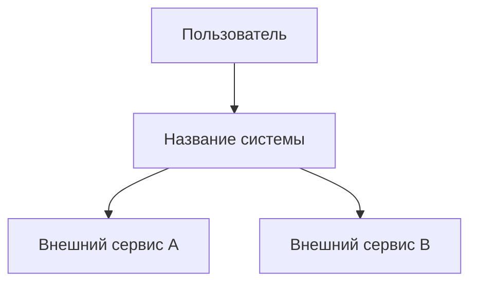
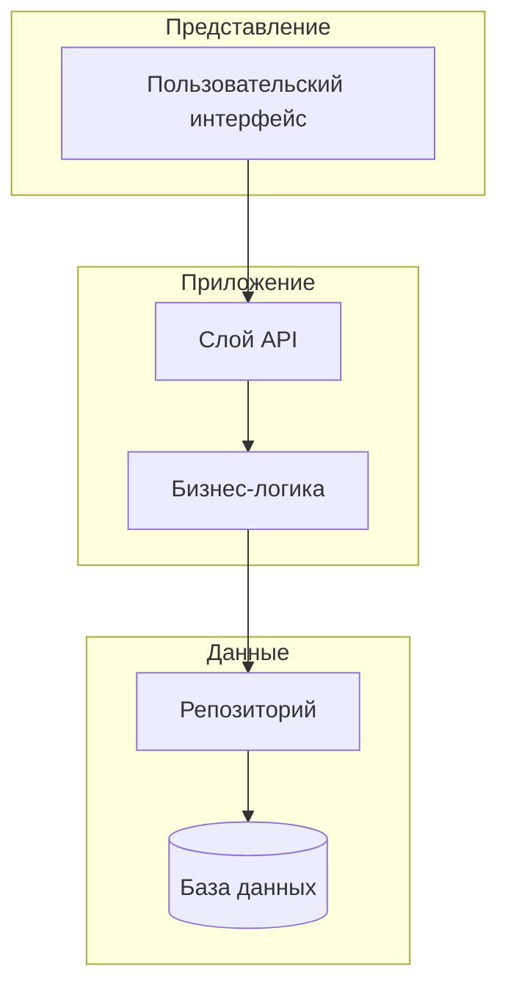
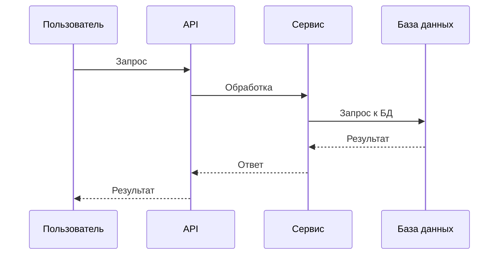

# Шаблон: архитектура

Скопируйте блок ниже в файл `docs/architecture.md` вашего проекта и замените заполнители.

````markdown
# [Название системы/функции]: архитектура

## Обзор

[Краткое описание системы и её назначения]

---

## Контекст системы



[Опишите, как система взаимодействует с внешними сущностями]

---

## Компоненты

### [Название компонента]

**Ответственность:** [Что делает этот компонент, в 1-2 предложениях]

**Интерфейсы:**

- Предоставляет: [Что могут вызывать другие компоненты]
- Использует: [От чего зависит этот компонент]

**Ключевые решения:**

- [Важный выбор реализации и обоснование]

---

### [Название компонента]

**Ответственность:** [Что делает этот компонент]

**Интерфейсы:**

- Предоставляет: [Что могут вызывать другие компоненты]
- Использует: [От чего зависит этот компонент]

**Ключевые решения:**

- [Важный выбор реализации и обоснование]

---

## Диаграмма компонентов



---

## Взаимодействия

### [Название потока]



---

## Сквозные аспекты

### Безопасность

- [Подход к безопасности: аутентификация, авторизация, шифрование]

### Обработка ошибок

- [Стратегия обработки ошибок между компонентами]

### Наблюдаемость

- [Подход к логированию, мониторингу, трассировке]
````
