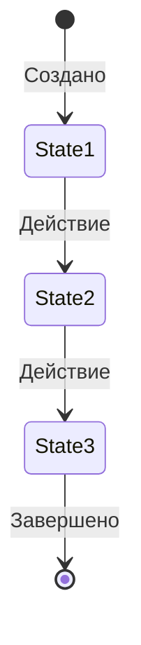
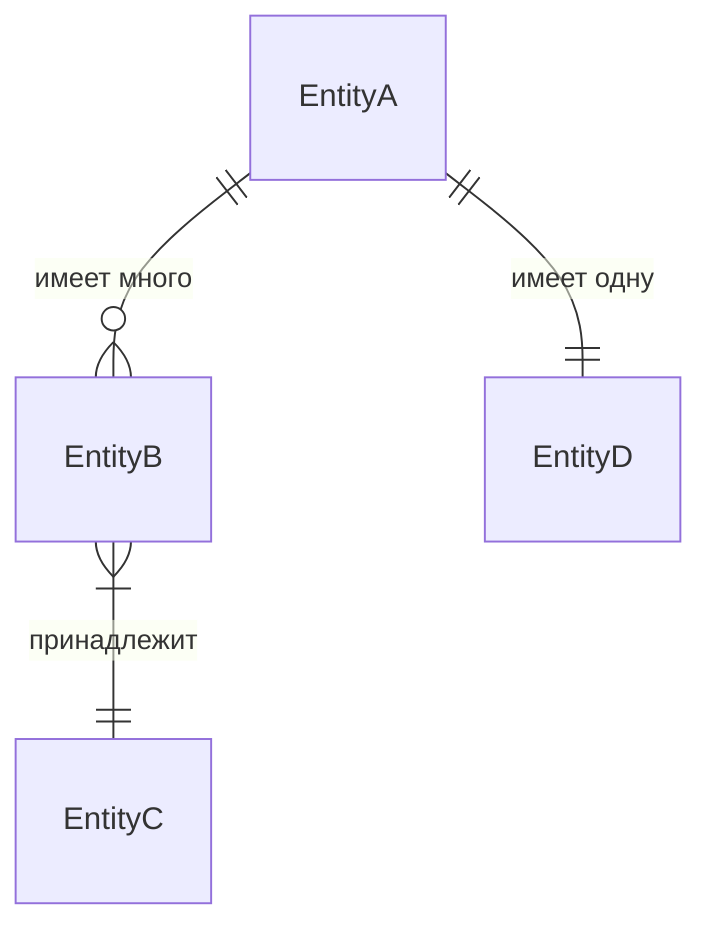

# Шаблон: модель данных

Скопируйте блок ниже в файл `docs/data-model.md` вашего проекта и замените заполнители.

````markdown
# [Домен/функция]: модель данных

## Обзор

[Краткое описание домена и того, какие данные представляет эта модель]

---

## Сущности

### [Название сущности]

**Описание:** [Что представляет эта сущность]

**Атрибуты:**

| Атрибут     | Тип       | Обязателен | Описание                              |
| ----------- | --------- | ---------- | ------------------------------------- |
| id          | UUID      | Да         | Первичный ключ (рекомендуется UUIDv7) |
| [атрибут]   | [тип]     | [Да/Нет]   | [Описание]                            |
| [атрибут]   | [тип]     | [Да/Нет]   | [Описание]                            |
| created_at  | timestamp | Да         | Когда сущность была создана           |
| updated_at  | timestamp | Да         | Когда сущность последний раз изменялась |

**Жизненный цикл:**



---

### [Название сущности]

**Описание:** [Что представляет эта сущность]

**Атрибуты:**

| Атрибут     | Тип     | Обязателен | Описание      |
| ----------- | ------- | ---------- | ------------- |
| id          | UUID    | Да         | Первичный ключ |
| [атрибут]   | [тип]   | [Да/Нет]   | [Описание]    |

---

## Связи



### [Название связи]

**Тип:** [Один-к-одному | Один-ко-многим | Многие-ко-многим]

**Описание:** [Объясните связь и любые ограничения]

**Атрибуты связи:** (если применимо)

- [атрибут]: [описание]

---

## Ограничения

### Бизнес-правила

- [Сущность] [описание ограничения]
- [Сущность] [описание ограничения]

### Ссылочная целостность

- [Поведение cascade/restrict при удалении/обновлении]

### Временные ограничения

- [Правила, основанные на времени, например end_date > start_date]

---

## Индексы

| Сущность    | Индекс         | Столбцы     | Назначение                  |
| ----------- | -------------- | ----------- | --------------------------- |
| [Сущность]  | [имя_индекса]  | [столбцы]   | [Зачем нужен этот индекс]   |
````
