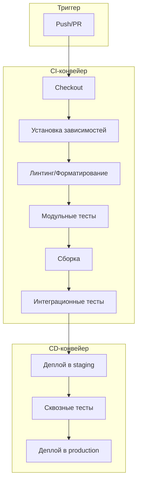
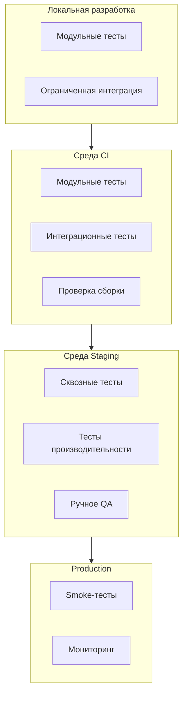
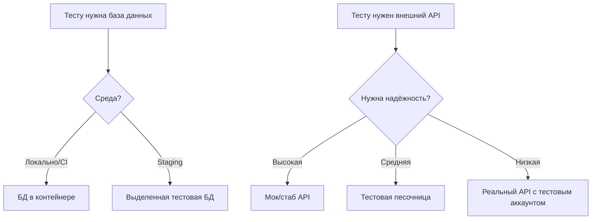
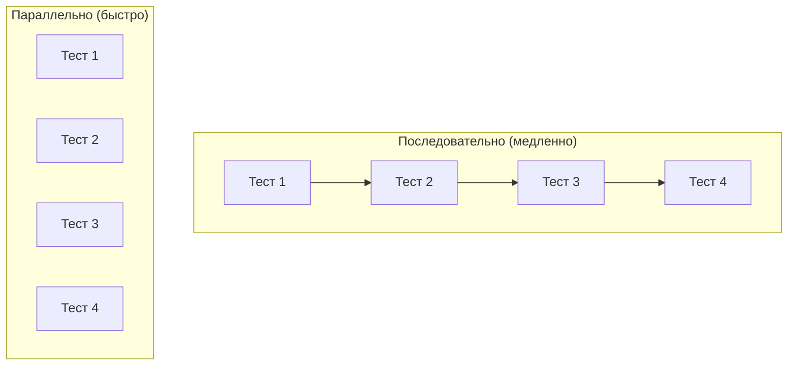
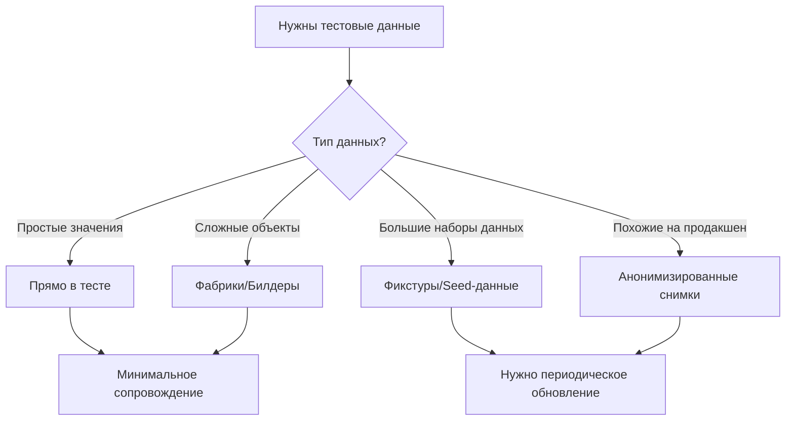
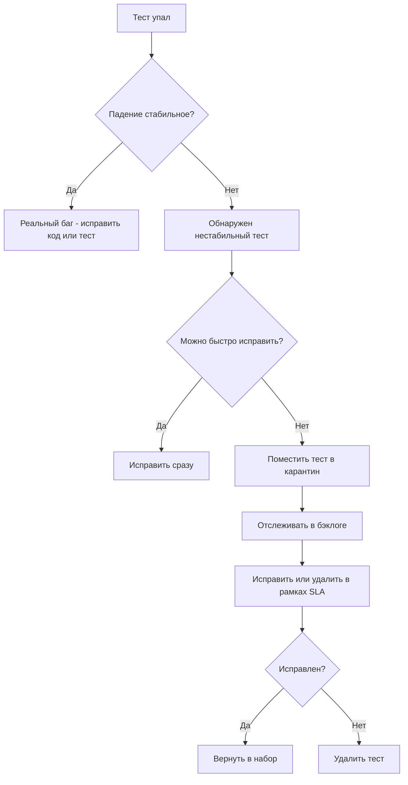
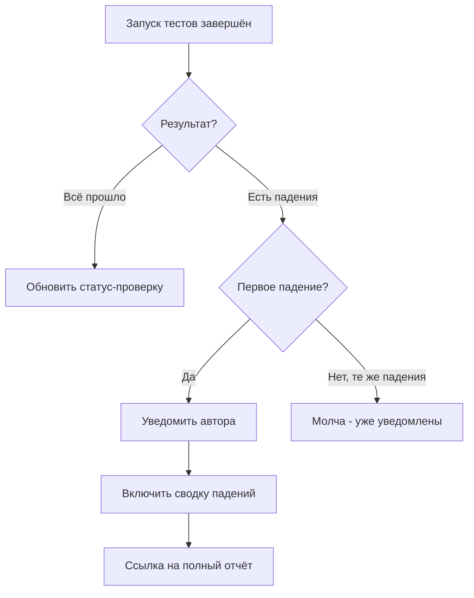
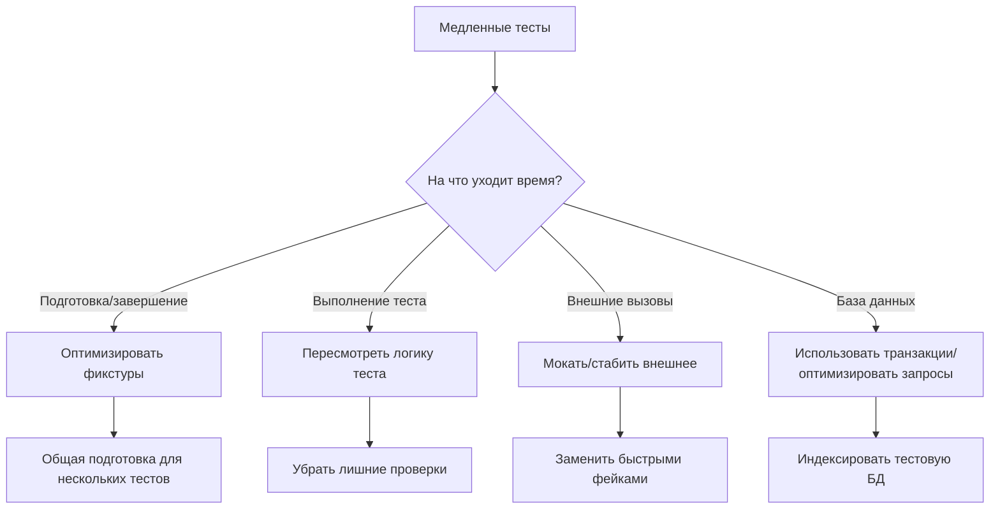

# Автоматизация тестирования

Автоматизация тестов запускает тесты автоматически, последовательно и часто. Этот документ описывает интеграцию тестов в конвейеры CI/CD и построение надёжной тестовой инфраструктуры.

---

## Образ мышления при автоматизации тестов

### Зачем автоматизировать тесты

Ручное тестирование не масштабируется:

- Люди непоследовательны
- Ручное тестирование медленное
- Повторяющееся тестирование подвержено ошибкам
- Тестирование пропускают под давлением сроков

Автоматизированные тесты дают:

- Единообразное выполнение каждый раз
- Быструю обратную связь об изменениях
- Уверенность при рефакторинге
- Документацию ожидаемого поведения

### Цели автоматизации

Основные цели:

- ✓ Быстрая обратная связь — быстро узнавать, ломают ли изменения что-то
- ✓ Стабильные результаты — те же тесты, те же условия, те же результаты
- ✓ Низкие затраты на сопровождение — тесты работают надёжно без присмотра
- ✓ Чёткие сигналы — «прошёл/упал» однозначно и применимо к действию

Анти-цели:

- ✗ 100% автоматизация — некоторые тесты лучше оставить ручными
- ✗ Автоматизация ради автоматизации — автоматизируйте то, что даёт ценность
- ✗ Сложная инфраструктура — проще значит надёжнее

---

## Интеграция с конвейером CI/CD

Непрерывная интеграция (CI) запускает тесты автоматически при изменении кода. Непрерывное развёртывание (CD) расширяет это до автоматического деплоя проверенного кода.

### Структура конвейера



### Этапы конвейера

**Этап 1: быстрые проверки (секунды)**

- Назначение: сразу поймать очевидные проблемы
- Запуск: при каждом push и PR

Шаги:

- Получение кода (checkout)
- Установка зависимостей (с кэшем)
- Проверки линтером и форматирования
- Проверка типов (если применимо)
- Сканирование безопасности (зависимости)

Падайте быстро: останавливайте конвейер при первой ошибке

**Этап 2: модульные тесты (минуты)**

- Назначение: проверить логику компонентов
- Запуск: при каждом push и PR

Шаги:

- Запуск набора модульных тестов
- Генерация отчёта о покрытии
- Проверка порогов покрытия

Параллелизация: разделите между несколькими раннерами

**Этап 3: сборка (минуты)**

- Назначение: проверить, что код компилируется/собирается в бандл
- Запуск: при каждом push и PR

Шаги:

- Сборка приложения
- Сборка артефактов для развёртывания
- Сохранение артефактов для последующих этапов

Кэширование: кэшируйте результаты сборки, когда возможно

**Этап 4: интеграционные тесты (от минут до часов)**

- Назначение: проверить взаимодействие компонентов
- Запуск: при слиянии PR, перед деплоем

Шаги:

- Запуск тестовых зависимостей (базы данных, сервисы)
- Запуск набора интеграционных тестов
- Очистка тестовых ресурсов

Изоляция: каждый запуск получает свежую среду

**Этап 5: сквозные тесты (от минут до часов)**

- Назначение: проверить полные рабочие сценарии
- Запуск: перед деплоем, по расписанию

Шаги:

- Деплой в staging-окружение
- Запуск набора сквозных тестов
- Сохранение скриншотов/видео при падении

Стабильность: повторяйте нестабильные тесты (с ограничениями)

---

## Тестовая инфраструктура

### Архитектура тестовых сред



### Паритет сред

Тестовые среды должны максимально соответствовать продакшену в практических пределах:

Критичный паритет:

- ✓ Те же версии ОС/рантайма
- ✓ Тот же тип и версия базы данных
- ✓ Те же конфигурации сервисов
- ✓ Та же сетевая топология (где применимо)

Допустимые различия:

- ~ Меньший масштаб (меньше экземпляров)
- ~ Синтетические данные (не продакшен-данные)
- ~ Упрощённые внешние сервисы (моки/стабы)
- ~ Сокращённые ресурсы (память, хранилище)

Опасные различия:

- ✗ Другой тип базы данных
- ✗ Отсутствующие сервисы
- ✗ Отключённые функции безопасности
- ✗ Зашитые в код конфигурации

### Тестовые зависимости

Управление внешними зависимостями в тестах:



**Зависимости в контейнерах:**

Преимущества:

- Единообразие между средами
- Быстрый старт (готовые образы)
- Изоляция для каждого запуска тестов
- Лёгкая очистка

Типичные сервисы:

- PostgreSQL, MySQL (базы данных)
- Redis, Memcached (кэши)
- RabbitMQ, Kafka (очереди сообщений)
- Elasticsearch (поиск)
- LocalStack (сервисы AWS)

**Работа с внешними сервисами:**

Варианты (от наиболее до наименее изолированного):

1. Моки (фейки в памяти)
   - Самые быстрые и надёжные
   - Могут не поймать проблемы интеграции
2. Стабы (лёгкие фейковые серверы)
   - Имитируют поведение API
   - Хороши для контрактного тестирования
3. Песочницы
   - Реальный сервис в тестовом режиме
   - Провайдер должен это поддерживать
4. Реальные сервисы
   - Самые реалистичные
   - Самые медленные, наименее надёжные
   - Риск побочных эффектов

---

## Параллелизация тестов

Параллельный запуск тестов сокращает время обратной связи.

### Стратегии параллелизации



**Параллелизация на уровне файлов:**

Каждый тестовый файл выполняется параллельно

- Просто реализовать
- Хорошая изоляция
- Возможно неравномерное распределение

Пример (4 раннера, 12 тестовых файлов):

- Раннер 1: файлы 1, 5, 9
- Раннер 2: файлы 2, 6, 10
- Раннер 3: файлы 3, 7, 11
- Раннер 4: файлы 4, 8, 12

**Параллелизация на уровне тестов:**

Отдельные тесты выполняются параллельно

- Максимальный параллелизм
- Требует тщательной изоляции
- Сложное управление ресурсами

Требования:

- Тесты не должны разделять состояние
- Изоляция базы данных для каждого теста
- Никаких зашитых портов/ресурсов

**Шардирование (Sharding):**

Разделение набора тестов между несколькими машинами

- Масштабируется горизонтально
- Сокращает общее время
- Требует логики распределения тестов

Пример:

- Машина 1: тесты A-M
- Машина 2: тесты N-Z

Умное шардирование:

- Разделение по исторической длительности
- Балансировка нагрузки между шардами
- Периодическая ребалансировка

### Требования к параллелизации

Тесты должны быть:

- Независимыми — ни один тест не зависит от другого
- Изолированными — нет разделяемого изменяемого состояния
- Идемпотентными — можно запускать многократно
- Детерминированными — одинаковый результат каждый раз

Избегайте:

- Общих записей в базе данных
- Зашитых идентификаторов ресурсов
- Изменения глобального состояния
- Тестов, зависящих от порядка

---

## Управление тестовыми данными

### Стратегии тестовых данных



**Данные прямо в тесте:**

Лучше всего для: простых данных, специфичных для теста

Пример:

```text
test "validates email format":
  valid_email = "user@example.com"
  invalid_email = "not-an-email"

  assert is_valid_email(valid_email)
  assert not is_valid_email(invalid_email)
```

**Фабрики/Билдеры:**

Лучше всего для: сложных объектов со значениями по умолчанию

Пример:

```text
UserFactory:
  default:
    name: "Test User"
    email: generated unique email
    role: "member"

  admin:
    extends default
    role: "admin"

test "admins can delete users":
  admin = UserFactory.create(admin)
  user = UserFactory.create()

  delete_user(admin, user)
  assert user_deleted(user)
```

**Фикстуры/Seed-данные:**

Лучше всего для: общих справочных данных, больших наборов данных

Структура:

```text
fixtures/
  users.json
  products.json
  categories.json
```

Загрузка:

```text
before_all:
  load_fixtures(["users", "products", "categories"])
```

Предостережения:

- Держите фикстуры минимальными
- Документируйте содержимое фикстур
- Храните фикстуры под контролем версий
- Периодически обновляйте

**Паттерны изоляции базы данных:**

Откат транзакции:

```text
before_each: begin_transaction()
after_each: rollback_transaction()
```

Быстро, но некоторые функции могут не работать внутри транзакций

Очистка базы данных:

```text
after_each: truncate_all_tables()
```

Медленнее, но реалистичнее

База данных на каждый тест:

```text
before_each: create_database()
after_each: drop_database()
```

Самое медленное, лучшая изоляция

---

## Управление нестабильными тестами

Нестабильные (flaky) тесты проходят или падают непоследовательно. Они подрывают доверие к набору тестов.

### Выявление нестабильных тестов

Признаки нестабильности:

- Тест проходит локально, падает в CI
- Тест падает периодически
- Тест падает только при запуске вместе с другими
- Тест падает под нагрузкой
- Тест падает около полуночи/на границах времени

Типичные причины:

- Гонки (race conditions)
- Логика, зависящая от времени
- Зависимости от внешних сервисов
- Разделяемое состояние между тестами
- Исчерпание ресурсов
- Недетерминированный порядок

### Реакция на нестабильные тесты



### Стратегия карантина

Процесс карантина:

1. Пометьте тест как помещённый в карантин
2. Уберите его из блокирующего конвейера
3. Запускайте отдельно для наблюдения
4. Установите SLA на устранение (например, 2 недели)
5. Исправьте или удалите до истечения SLA

Ограничения карантина:

- Максимум 5% тестов в карантине
- Максимум 2 недели в карантине
- Требуется одобрение для помещения в карантин

---

## Отчёты и уведомления

### Отчёты о тестах

Основная информация отчёта:

- Общее число запущенных тестов
- Количество прошедших/упавших/пропущенных
- Длительность (общая и по каждому тесту)
- Детали падений со стек-трейсами
- Индикаторы нестабильных тестов
- Метрики покрытия

Форматы отчётов:

- JUnit XML (интеграция с CI)
- HTML (читаемо человеком)
- JSON (программный доступ)

### Стратегия уведомлений



**Принципы уведомлений:**

Делайте:

- ✓ Уведомляйте о первом падении
- ✓ Включайте информацию, пригодную для действий
- ✓ Давайте ссылки на логи и артефакты
- ✓ Уведомляйте только соответствующих людей

Не делайте:

- ✗ Спам при каждом запуске
- ✗ Уведомления об ожидаемых падениях
- ✗ Стены текста
- ✗ Уведомление всей команды из-за PR одного человека

---

## Паттерны CI-платформ

### Лучшие практики CI

**Кэширование:**

Кэшируйте агрессивно:

- Зависимости (node_modules, venv)
- Результаты сборки
- Слои Docker
- Тестовые фикстуры

Ключи кэша:

- Включайте хэш lock-файла
- Включайте релевантные конфигурационные файлы
- Версионируйте формат кэша

Пример ключа: `deps-{{ checksum "package-lock.json" }}`

**Артефакты:**

Сохраняйте полезные артефакты:

- Результаты сборки
- Отчёты о тестах
- Отчёты о покрытии
- Скриншоты/видео (E2E)
- Логи при падении

Хранение:

- Короткое для сборок PR (7 дней)
- Дольше для релизных сборок (90 дней)
- Постоянное для продакшен-артефактов

**Управление секретами:**

Делайте:

- ✓ Используйте хранилище секретов CI-платформы
- ✓ Ограничивайте доступ к секретам по ветке/окружению
- ✓ Регулярно ротируйте секреты
- ✓ Аудируйте доступ к секретам

Не делайте:

- ✗ Не коммитьте секреты в репозиторий
- ✗ Не печатайте секреты в логах
- ✗ Не делите секреты между окружениями
- ✗ Не используйте продакшен-секреты в CI

---

## Оптимизация производительности тестов

### Выявление медленных тестов

Измеряйте:

- Общую длительность конвейера
- Длительность по этапам
- Длительность по тестовым файлам
- Самые медленные отдельные тесты

Инструменты:

- Аналитика CI-платформы
- Отчёты о времени тестового фреймворка
- Собственная инструментация времени

### Техники оптимизации



**Типичные оптимизации:**

Быстрые победы:

- Параллельное выполнение тестов
- Кэширование зависимостей
- RAM-диск для базы данных
- Общая дорогая подготовка

Средние усилия:

- Профилирование и оптимизация медленных тестов
- Замена медленных моков более быстрыми
- Сокращение объёма тестовых данных
- Разделение больших тестовых файлов

Большие усилия:

- Внедрение шардирования тестов
- Обновление инфраструктуры CI
- Переписывание медленных тестовых паттернов
- Архивация редко нужных тестов

---

## Чек-лист автоматизации тестирования

### Настройка конвейера

- [ ] Тесты запускаются при каждом push/PR
- [ ] Быстрые проверки идут первыми
- [ ] Конвейер быстро падает при ошибках
- [ ] Кэширование зависимостей настроено
- [ ] Артефакты хранятся должным образом
- [ ] Секретами управляют безопасно

### Тестовая инфраструктура

- [ ] Тестовые среды задокументированы
- [ ] Зависимости в контейнерах или замоканы
- [ ] Изоляция базы данных настроена
- [ ] Стратегия тестовых данных определена
- [ ] Паритет сред проверен

### Надёжность

- [ ] Тесты детерминированы
- [ ] Тесты могут выполняться параллельно
- [ ] Процесс работы с нестабильными тестами определён
- [ ] Политика карантина действует
- [ ] SLA на устранение нестабильных тестов установлен

### Мониторинг

- [ ] Отчёты о тестах генерируются
- [ ] Покрытие отслеживается во времени
- [ ] Стратегия уведомлений определена
- [ ] Длительность конвейера мониторится
- [ ] Доля нестабильных тестов отслеживается

### Сопровождение

- [ ] Регулярный пересмотр конвейера запланирован
- [ ] Оптимизация медленных тестов запланирована
- [ ] Обновления зависимостей автоматизированы
- [ ] Документация поддерживается в актуальном состоянии
- [ ] Команда обучена практикам CI/CD
