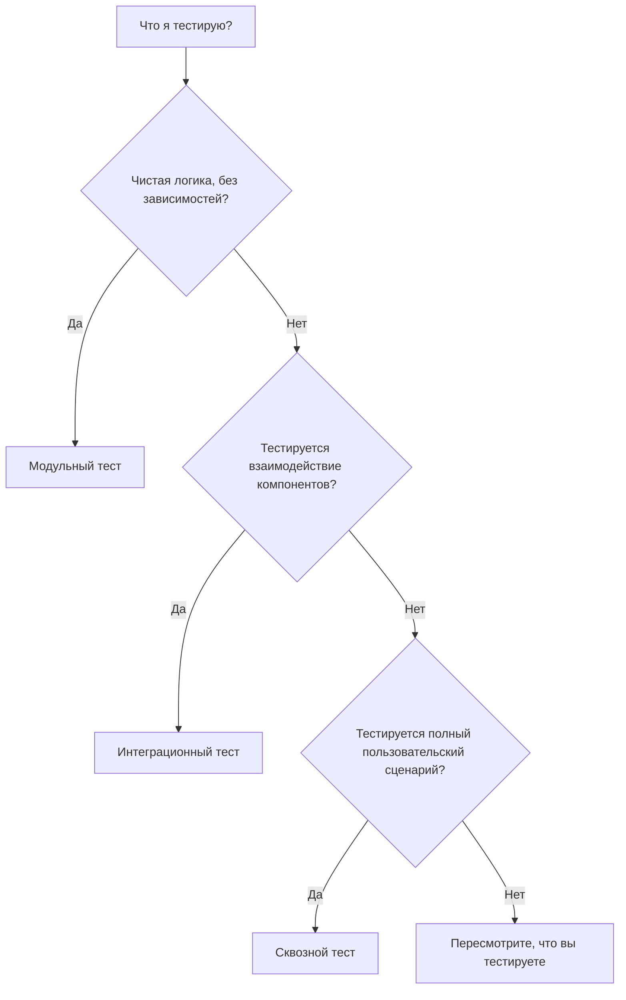

# Стратегия тестирования

Определяет, что тестировать, на каком уровне и в каком объёме. Максимум уверенности при минимуме усилий.

---

## Принципы стратегии

### Тестирование на основе рисков

Направляйте усилия по тестированию туда, где риск наибольший.

**Высокий риск:**

- Основная бизнес-логика
- Код, чувствительный к безопасности
- Финансовые расчёты
- Операции с целостностью данных
- Сложные алгоритмы

**Низкий риск:**

- Простые геттеры/сеттеры
- Код-«прокладка» (pass-through)
- Косметика интерфейса
- Конфигурация

Распределяйте усилия по тестированию пропорционально риску.

### Пирамида тестирования

Пирамида тестирования определяет распределение типов тестов:

```text
        /\
       /  \        Мало сквозных тестов (медленные, широкие)
      /----\
     /      \      Некоторое число интеграционных (средние)
    /--------\
   /          \    Много модульных тестов (быстрые, сфокусированные)
  --------------
```

**Модульные тесты** — фундамент. Быстрые, изолированные, многочисленные. **Интеграционные тесты** — проверяют границы. Медленнее, их меньше. **Сквозные тесты** — проверяют полные сценарии. Самые медленные, самые малочисленные.

---

## Определение уровня тестов



### Сравнение уровней тестов

| Аспект | Модульные | Интеграционные | Сквозные |
| --- | --- | --- | --- |
| **Когда применять** | Одна функция, чистая логика, крайние случаи | Взаимодействие компонентов, реальные зависимости | Полные пользовательские сценарии |
| **Скорость** | Миллисекунды | Умеренная | Самая низкая |
| **Зависимости** | Нет | Реальные или реалистичные фейки | Вся система |
| **Фокус** | Одна вещь на тест | Контракты между компонентами | Пользовательские пути |
| **Количество** | Много | Несколько | Мало (держите минимум) |

---

## Планирование покрытия

### Что покрывать

**Обязательно покрывать:**

- Все критерии приёмки из требований
- Все заданные условия ошибок
- Операции, чувствительные к безопасности
- Операции с целостностью данных

**Желательно покрывать:**

- Типичные пути выполнения кода
- Крайние случаи
- Пути обработки ошибок
- Точки интеграции

**Можно не покрывать:**

- Тривиальный код (простые геттеры, конфигурация)
- Код внешних библиотек (если вы его не оборачиваете)
- Временный отладочный код

### Цели по покрытию

Задайте подходящие цели:

- Критичные пути: покрытие 90%+
- Основная бизнес-логика: покрытие 80%+
- Инфраструктурный/связующий код: покрытие 50-70%
- В целом: обычно достаточно 70-80%

Цифры покрытия — ориентиры. Осмысленные тесты важнее процентов.

### Пробелы в покрытии

Допускайте некоторые пробелы:

- Код, который действительно трудно тестировать, может не стоить усилий
- Некоторый код меняется так редко, что тесты могут не понадобиться
- Некоторый код лучше проверять другими средствами (код-ревью, статический анализ)

Документируйте намеренные пробелы в покрытии и их обоснование.

---

## Планирование тестов

### Планирование по функциям

Для каждой функции или требования:

```text
Feature: User Registration

План тестового покрытия:
  Модульные тесты:
    - Логика валидации email
    - Валидация надёжности пароля
    - Проверка уникальности имени пользователя

  Интеграционные тесты:
    - Поток регистрации с базой данных
    - Обработка дубликатов email
    - Процесс подтверждения email

  Сквозные тесты:
    - Полный путь регистрации
```

### Планирование по компонентам

Для каждого компонента:

```text
Component: PaymentService

План тестового покрытия:
  Модульные тесты:
    - Расчёт суммы
    - Валидация ввода
    - Сопоставление ошибок

  Интеграционные тесты:
    - Взаимодействие с платёжным шлюзом
    - Запись транзакций
    - Обработка сбоев

  Зависимости:
    - Мок платёжного шлюза для модульных тестов
    - Тестовый платёжный шлюз для интеграционных тестов
```

---

## Тестовая среда

### Требования к среде

Разные уровни тестов требуют разных сред:

**Модульные тесты:**

- Без внешних сервисов
- Без базы данных
- Без сетевых вызовов
- Быстрый старт

**Интеграционные тесты:**

- Тестовая база данных (локальная или в контейнере)
- Моки или тестовые версии внешних сервисов
- Контролируемая среда

**Сквозные тесты:**

- Развёрнута вся система
- Подготовка тестовых данных
- Изоляция от продакшена

### Управление данными

Потребности в тестовых данных:

- **Подготовка (setup)** — создать необходимые данные до тестов
- **Изоляция** — тесты не влияют на данные друг друга
- **Очистка (cleanup)** — удалять тестовые данные после тестов
- **Детерминизм** — одинаковые данные дают одинаковые результаты

---

## Чек-лист стратегии

Планирование:

- [ ] Области риска определены
- [ ] Уровни тестов определены для каждой области
- [ ] Цели по покрытию заданы
- [ ] Критичные пути определены
- [ ] Крайние случаи перечислены

Ресурсы:

- [ ] Тестовая среда доступна
- [ ] Стратегия тестовых данных определена
- [ ] Зависимости можно замокать или протестировать

Документация:

- [ ] План тестирования задокументирован
- [ ] Ожидания по покрытию ясны
- [ ] Намеренные пробелы задокументированы

---

## Антипаттерны стратегии

### Рожок мороженого (Ice Cream Cone)

Перевёрнутая пирамида: много сквозных тестов, мало модульных.

Проблемы:

- Тесты медленные
- Падения трудно диагностировать
- Тесты хрупкие
- Цикл обратной связи медленный

Решение: переверните пирамиду. Спускайте тестирование на уровень модульных тестов.

### Тестировать всё

Попытка достичь 100% покрытия везде.

Проблемы:

- Убывающая отдача
- Потраченные впустую усилия на тривиальный код
- Тесты становятся бременем сопровождения
- Театр покрытия (высокие цифры, слабые тесты)

Решение: сосредоточьтесь на риске и ценности. Принимайте стратегические пробелы.

### Не тестировать ничего

Нет автоматизированных тестов; опора на ручное тестирование.

Проблемы:

- Риск регрессий
- Медленная и дорогая проверка
- Страх перед изменениями
- Качество со временем деградирует

Решение: начните с областей высокого риска. Выстраивайте привычки тестирования постепенно.

### Тестирование реализации

Тесты, проверяющие, как код работает внутри, а не что он делает.

Проблемы:

- Тесты ломаются при изменении реализации
- Тесты дают ложную уверенность
- Рефакторинг становится болезненным

Решение: тестируйте поведение и контракты, а не внутреннюю структуру.

---

## После определения стратегии

Когда стратегия определена:

1. Задокументируйте план тестирования
2. Настройте тестовые среды
3. Начните реализовывать тесты согласно стратегии
4. Отслеживайте покрытие относительно целей
5. Корректируйте стратегию по мере накопления опыта

Стратегия развивается — пересматривайте её при изменении требований или появлении пробелов.
